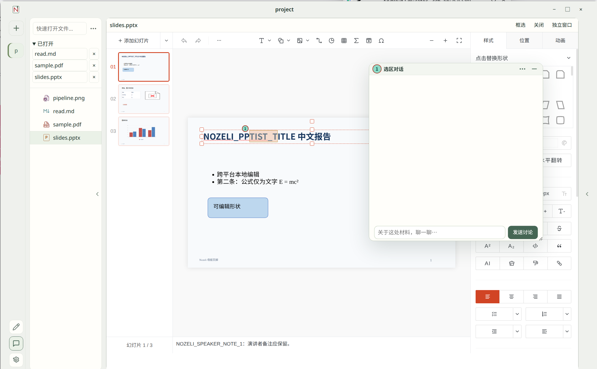

# Nozeli

**Agent 协作编辑工作台**

协调你与 Agent 的协作节奏，让你看懂结果、参与修改，持续掌握项目进展。

主要特点：
- 以对话为起点、以结果报告为中心，形成任务闭环。
- 通过立体文档交互与朱批锚定视觉位置，让 Agent 跟得上你的视线。
- 前台—调度—专家多 Agent 协作，流畅推进任务。
- 集成多种编辑器，有时自己动手比开口描述更快。

## 快速链接

[开始使用](docs/user-guide.md) · [开发说明](apps/desktop/README.md) · [项目文档](docs/README.md)

*文档、选区与讨论在同一工作面。上图展示 PPT 选区讨论入口。*

## 为什么使用 Nozeli

### Agent 效率高，你也要接得住

Agent 交付得快，不代表人已经理解。Nozeli 希望让你看清成果与依据，审核、提问、提出修改，再由 Agent 继续推进，而不是逐渐失去对项目的掌握。

后台任务以可阅读的 HTML 报告交付，必要时使用 Archify 结构图解释流程与关系。你可以核对报告及候选文件差异，提出修改，再明确接受成果；保存批注不会自动派工，接受处理方案也不等于自动接受最终成果。

### Agent 长时执行任务，你也不必停

前台—中枢—专家多 Agent 模式中，前台快速响应与分流，后台专家各自推进整块任务，中枢负责派发与收尾。你可以继续阅读、编辑、交流并发布新任务；成果准备好后，再按自己的节奏审阅，不必守着进度条。

### 有时指挥不如动手

人能同时直接编辑、批注，Agent 也能协助修改。不必反复把原文贴进聊天框，再把回复搬回文档；围绕同一份材料查看修改、反馈并继续修订，并显示作者。

### 从“这里”入手，解决人与 Agent 的视觉对齐

**Agent anywhere。** 与 Agent 在项目中立体交互，而非限制在一个侧边栏对话框。右键、框选和涂鸦都是对话锚点，对话会保存在对应位置。不必再反复解释“哪个文件、第几页、哪一段、图上哪里”。

### 把材料、对话与成果摆在一起

拖动标签拆分工作区，并排阅读文档、讨论和文件差异；需要更大空间时，将内容脱离为独立窗口，放到另一块屏幕，再移回主工作区。布局变化不复制文件，也不应丢失未保存编辑或原会话。

总之，让你游刃有余地掌控自己的项目，而不是跟着 Agent 跑。

## 开始使用

1. 打开本地项目目录和需要阅读、编辑的材料。
2. 在设置中配置 AI 源与角色默认模型；AI 使用随应用提供的私有 OMP。
3. 直接交流，或从选区发起讨论；普通文件操作与当前用户命令可直接执行，持续后台工作沿原任务交接。敏感／管理员执行从同项目待办明确授权，系统提权仍由真实 OS 认证完成；角色分工不会把已授权能力变成“没有权限”。
4. 从待办查看问题与成果，继续修改，或明确接受／丢弃并结束。

推荐从四个功能开始：选中文字或框选区域添加**批注与讨论**；通过工作与待办完成**后台任务的报告—审阅—修改—接受闭环**；拖动标签进行**分屏**；从内容菜单打开**独立窗口**。文本候选文件的差异在统一工作区中查看，不必学习另一套报告内编辑器。

## 当前状态

- 面向 Windows、macOS、Linux；当前验证以 **Linux x64／Wayland** 为主，其他平台尚未通过。
- 已有阅读、批注、编辑、真实文件与后台协作工作流；具体格式、版本和能力边界见[当前状态与能力边界](docs/status.md)。
- **公开 Alpha 预发布** [`v0.1.0-alpha.1`](https://github.com/SeemSeam/nozeli/releases/tag/v0.1.0-alpha.1)（源提交 `af004b4`；Linux x64 便携包＋源码快照＋SHA-256 校验和；仅 Linux 本机验证，Windows/macOS 未验证），含空工作台四项推荐功能引导（批注与选区讨论、任务闭环、分屏阅读、独立窗口）。
- 第三方源码与再分发审计未完成（源码 vendor 产物与捆绑二进制对应源码/通告义务均未签收）：发布不是合规认证，本仓库源码归档或上游链接不自动满足对应源码义务；逐项义务、pinned 版本与签收状态见[发布说明与发行边界](docs/release.md)与[合规清单](apps/desktop/compliance-inventory.json)。

## 进一步了解

- [产品文档：方向、状态与原则](docs/README.md) · [发布说明与发行边界](docs/release.md)
- [阅读与协作原则](docs/principles.md)
- [桌面开发与验证](apps/desktop/README.md) · [私有 OMP 集成](integrations/omp/README.md) · [第三方来源与许可](apps/desktop/SOURCES.md) · [合规清单](apps/desktop/compliance-inventory.json)

## 参与贡献

- [用户指南](docs/user-guide.md) · [测试说明](docs/testing.md) · [贡献指南](CONTRIBUTING.md) · [行为准则](CODE_OF_CONDUCT.md)
- 安全漏洞请按 [SECURITY.md](SECURITY.md) 私下报告，勿公开张贴。

## 开源许可

Nozeli 自有代码采用 **[AGPL-3.0-only](LICENSE)**。第三方组件保留原许可证，见[来源与许可](apps/desktop/SOURCES.md)与机器可读[合规清单](apps/desktop/compliance-inventory.json)。源码开放不代表全部第三方二进制分发义务已完成，公开预发布不改变该边界。

## Thanks

感谢这些开源项目及其贡献者：

- 桌面与运行时：[Electron](https://github.com/electron/electron)、[Chromium](https://www.chromium.org/)、[oh-my-pi](https://github.com/can1357/oh-my-pi)、[Bun](https://github.com/oven-sh/bun)。
- 阅读与编辑：[PDF.js](https://github.com/mozilla/pdf.js)、[Monaco](https://github.com/microsoft/monaco-editor)、[CodeMirror](https://codemirror.net/)、[Lezer](https://lezer.codemirror.net/)、[Shiki](https://github.com/shikijs/shiki)、[KaTeX](https://github.com/KaTeX/KaTeX)。
- Office：[SuperDoc](https://github.com/superdoc-dev/superdoc)、[PPTist](https://github.com/pipipi-pikachu/PPTist)、[Fortune Sheet](https://github.com/ruilisi/fortune-sheet)、[ExcelJS](https://github.com/exceljs/exceljs)、[JSZip](https://github.com/Stuk/jszip)、[word-extractor](https://github.com/morungos/node-word-extractor)。
- 报告与结构图：[Archify 离线静态渲染](apps/desktop/src/agents/managed/archify-vendor/SOURCES.json)（MIT；原作者 tt-a1i 与 Cocoon AI，详见[保留的许可证](apps/desktop/src/agents/managed/archify-vendor/LICENSE)）、[Simple Icons](https://simpleicons.org/)（内置图标路径，CC0；商标权不在许可范围内）。
- 界面与终端：[React](https://github.com/facebook/react)、[xterm.js](https://github.com/xtermjs/xterm.js)、[node-pty](https://github.com/microsoft/node-pty)、[Lucide](https://github.com/lucide-icons/lucide)、[Feather](https://github.com/feathericons/feather)、[IconPark](https://github.com/bytedance/IconPark)、[Font Awesome](https://github.com/FortAwesome/Font-Awesome)。
- 文件与工具：[Git](https://git-scm.com/)、[dugite](https://github.com/desktop/dugite)、[dugite-native](https://github.com/desktop/dugite-native)、[Git LFS](https://github.com/git-lfs/git-lfs)、[Git Credential Manager](https://github.com/git-ecosystem/git-credential-manager)、[xmldom](https://github.com/xmldom/xmldom)、[image-size](https://github.com/image-size/image-size)、[YAML](https://github.com/eemeli/yaml)、[ws](https://github.com/websockets/ws)。
- 开发：[TypeScript](https://github.com/microsoft/TypeScript)、[TypeScript Language Server](https://github.com/typescript-language-server/typescript-language-server)、[VS Code Language Server Node](https://github.com/microsoft/vscode-languageserver-node)、[Prettier](https://github.com/prettier/prettier)、[esbuild](https://github.com/evanw/esbuild)、[electron/rebuild](https://github.com/electron/rebuild)、[Puppeteer](https://github.com/puppeteer/puppeteer)。
- 可选工具：[bubblewrap](https://github.com/containers/bubblewrap)、[TeX Live](https://tug.org/texlive/)、[latexmk](https://ctan.org/pkg/latexmk)、[Tectonic](https://github.com/tectonic-typesetting/tectonic)、[TexLab](https://github.com/latex-lsp/texlab)、[SyncTeX](https://github.com/jlaurens/synctex)。
