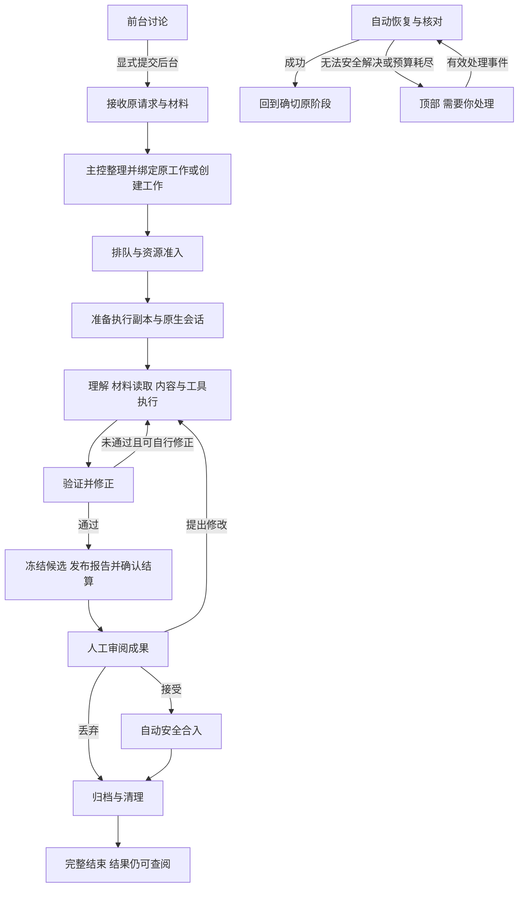

# 人工修复与任务控制：生命周期协同设计

日期：2026-11-02。状态：生产源码已接入并通过 Reviewer 与 Linux 源码验收（§13）；随后经用户授权完成实际用户级安装及按设计目标的安装版系统测试（§14）。未提交或公开发布，未操作用户业务项目。

基线：[Agent 生命周期与任务自动修复协同合同](agent-task-repair-lifecycle-design.md) §7、[Agent 状态与模型](agent-conversation-status-demo.md) §10–11。继承既有项目 Controller、Work/job/维修账本、Pi 原生会话与全局 owner 管理，不建立第二任务系统。

## 1. 决策

人工控制控制的是**原任务是否允许继续执行**；自动生命周期控制的是**某个原生 owner 是否可安全卸载**。两者独立：用户暂停不等于结束 Work，owner 休眠不等于暂停任务，恢复任务不等于重启整个项目。

三种恢复必须分开：

| 类型 | 用户入口 | 实际效果 |
| --- | --- | --- |
| 外部服务故障解除 | 工作区顶部「故障解除，继续」 | 核对该故障影响集合，只恢复安全的原工作；不要求逐任务操作 |
| 宿主事务维修 | 协作详情「重试修复」或「完成维修收尾」 | 调用现有 maintenance.retry，服从实时 capability；不重发原 prompt |
| 人工任务控制 | 工作跟踪任务菜单「暂停调度／停止当前执行／恢复」 | 修改原 Work 的人工执行门；不自动接受、丢弃或清除其他阻塞 |

共同原则：可自动解决的静默处理并记录日志；需要充值、登录、权限、业务决定或未知效果核查的才提醒。一次失败不能推断欠费；一次用户解除不能授权无限重试、重置维修次数或重建冷开丢失的 action。

## 2. 接入前基线与本轮范围

接入前 executor 汇总 `/var/tmp/nozeli-production-repair-final-report.json` 记录 Linux x64 默认 2158 项、live 36 项、smoke 5 脚本与专项 73 项；设计阶段只读取过该汇总与原件，不把这些历史数字叠加到本轮运行结果。它们不覆盖随后新增的人工控制、外部故障聚合、跨项目恢复及队列政策。

| 基线事实 | 可复用 | 本提案不能据此宣称 |
| --- | --- | --- |
| managed.collaboration.status 有界分页、live/recorded、新鲜度、owner与Work身份 | UI状态和动作资格的输入；冷读不创建Controller/owner | primaryState='paused'就是用户主动暂停；已有通用pause/stop API |
| managed.maintenance.status 有界标量DTO及 binding/capabilities | 同一维修事实的详情、分页与按钮 | 中文状态文本、attemptCount或一个bug ID足以授权重试 |
| managed.maintenance.retry 验证原binding及实时capability | 原事务效果修复与finalize-only | 用户点击能绕过两次效果尝试或冷启动重建action |
| Controller hostOperations / maintenanceFlights / closure保护 | 停止、维修、发布与闲置回收协同 | 任意时刻强杀进程也不会丢结果 |
| 安全连续空闲默认5分钟回收，原线程按需恢复 | 人工暂停后的安全卸载，恢复时按需加载 | 休眠释放Work名额，状态查询唤醒Agent |
| 全局owner硬上限与项目Work配额独立 | 资源不足排队，capacity-released再调度 | 每项目固定2个Worker、收尾complete才释放已全面实现 |
| providerRuntimeDiagnostic 普通连接/Provider失败本地记账，不自动扇出 | 保留零诊断风暴底线 | 新的网络/API自动修复已生产接入 |
| coldJobs/coldQueued不自动重放 | 原输入与未知效果保护 | 重启后所有排队/运行任务自动继续 |

源码核对入口：`managed-projects.mjs` 的 collaborationStatus/maintenanceStatus/invoke；`managed/{controller,maintenance-status,collaboration-status,agent-idle-lifecycle,maintenance-ledger}.mjs`。现有restart是owner重启，Controller.stop是项目关闭，不作为新任务恢复/单项停止的替身。

## 3. 界面收敛

### 3.1 工作区顶部：仅必须用户处理的故障

默认一行标题、一行范围、一个主操作与详情。例如：

> 额度不足 · 2个项目 / 5项工作　[故障解除，继续] [详情]

同一故障按服务端点身份、账号/凭据配置身份（不含密钥）、错误类别及必要模型范围聚合；文本相同、Provider品牌相同或HTTP码相同不足以跨账号合并。故障范围由宿主关联已受影响的job/Work，不按「所有paused」推测。

修复中无顶部提醒。用户解除失败，原故障卡更新为「仍未恢复」，不新建重复卡、不要求结束或删除任务。解除成功只短暂/可收起显示结果，不把历史故障常驻。

### 3.2 右侧：待办在上，工作目录在下

待办动态高度，最多约40%，超出内部滚动。顺序为需用户决定、结果待审；关键服务故障不再复制成第二张待办卡。未知执行与权限/偏离决定属于真正人工事项，保留处理入口。

工作分类仅做派生展示，不创建第二套状态。默认只显示「全部」「进行中」及「…」；进行中包含尚需推进的提交、编排、排队、执行、待审、故障与未完成结束处理。其余细分放入更多菜单，选中时明确显示当前筛选，保留项目筛选与滚动位置。标题用「N 项待完成／暂无待完成任务」，不再裸露 0 或 W；处理名额按需在更多菜单中用「已占用 X 项，上限 Y 项」说明，不混同原生进程额度。待办「已完成历史」更名为「历史」，内部筛选语义不变。

### 3.3 对话与协作条

复用生产协作状态条，分别显示原生owner休眠/运行与Work推进/待审；不复制另一份Agent列表。读状态、打开任务、选模型、查看日志均不唤醒Agent。任务菜单与按需详情调用同一人工控制入口；本提案不新增全局暂停面板，也不改前台普通聊天发送语义。

### 3.4 任务结束后的结果入口（用户反馈收敛）

任务列表优先呈现真实成果：已有最终报告的待审／已结束工作点击后打开原冻结报告，保留 objectId 与 revision，不以工作详情替代报告，也不把结束或技术收尾成功当作业务成果。未执行、取消或未交付报告的工作打开简洁「任务概览」，明确没有最终报告。概览默认只保留名称、用户可理解的状态、结果与必要动作；长原始需求、版本、回执和技术收尾记录折叠按需查看。连接／模型／维修与全局历史不混入单任务概览；权限、冲突与需要用户决定的事项仍显式可见。此调整仅改变展示和导航，不生成模型报告、不修改旧报告、不改变结束／接受／重试授权。

## 4. 最小持久控制事实

### 4.1 Work人工执行门

在现有Work规范记录追加最少控制事实，逻辑形状如下（字段命名实施时沿源码收敛，**不是现有API**）：

- `manualControl.version`：独立CAS版本，不为点暂停冒增业务内容revision。
- `manualControl.paused`：用户明确阻止后续业务准入；不能从现有paused状态迁移推断。
- 停止操作记录：操作键、精确job/run/owner绑定、requested/confirming/confirmed/unknown及证据引用。复用现有效果回执机制；不存第二份完整任务或会话正文。
- 恢复所需的来源只允许当前live非cold且交付协议准许重试的原输入、现有确切注册恢复动作或用户另行明确的新输入（见§7）；解除hold成功与是否能开始执行分别返回，不伪造续作或重发原prompt。

现有problem/deviation/permission/recovery/maintenance是独立阻塞。有效准入=人工门允许且其他门均允许，不用一个枚举覆盖所有原因。

人工暂停只设置执行门，不能强制把正在运行的Work改成paused：当前发布要求running，提前改状态会破坏正常交付。解除人工门也不能借`Workspace.continueState()`实现：该方法会增业务revision并处理todo，属于新的业务续作，不是控制解锁。

接收请求尚未生成Work时，人工暂停绑定原接收job，生成Work时在同一事务继承；不使用空Work ID或任务名猜对象。

### 4.2 外部故障事实

按项目把故障与原job/Work/范围修订关联，保存类别、来源配置身份、准入结果、恢复能力/原因、有限尝试与日志引用；原始密钥、用户正文和完整堆栈不进入聚合DTO。

应用级仅做有界派生聚合及一次用户解除的批次回执：成员为project+instance+fault版本+Work/job绑定。不是第二个Work账本，不复制项目任务状态，不扫描完整原生日志。批次成员/逐项结果持久化是跨项目崩溃恢复所需的最少事务事实，不能只存在renderer内存中。

## 5. 人工暂停、停止、恢复与结束

| 操作 | 准确含义 | owner与维修 | 槽位 |
| --- | --- | --- | --- |
| 暂停调度 | 事务落盘后阻止新的业务job/prompt准入；已经准入的当前回合及其工具继续正常完成 | 已开始宿主发布/验证/落账正常收敛；不冻结进程、不挂起工具请求 | 已激活Work继续占业务槽 |
| 停止当前执行 | 先暂停，再对精确当前run请求取消并确认停稳 | 只等待该target/job/Work的写入/发布/维修flight及真实共享依赖安全结算，再核验原生退出 | 未确认保留owner额度；不结束Work |
| 恢复 | 解除人工门；重新评估有确切可执行来源的资格 | sleeping按需恢复同thread；已有busy owner只用原owner；退出中等待 | 不新建Work，不越全局owner额度 |
| 采用/丢弃并结束 | 用户绑定候选/版本作决定，走原closure | 停止、整合、归档、清理仍由宿主推进 | 拟改为完整closure后释放，见§9 |

暂停不撤销已发生效果。停止超时显示「停止未确认」，不是「已停止」；禁止替代owner启动，不自动强杀。用户可查看原证据，后续核对仍绑定原停止操作。

暂停不拦截已经准入回合的后续工具请求，不以普通工具错误驱动模型重试或无限等待。要立即打断该回合应使用stop-current；其原job按真实取消/效果事实结算，不误生成「缺少报告」业务recovery。stop先提交hold后若owner已替换，保留hold成功并返回stop stale部分结果，不回滚hold、不停止新owner；同requestKey返回原回执。

普通补充输入可保存，但不得解除人工门或触发后台续作绕过。保存输入时明确「已保存，等待恢复」；草稿不因暂停/停止/窗口切换被消费。读只读来源不被人工暂停禁用。

恢复不能回答权限问题、批准偏离、接受报告或复活已结束Work。review只解除人工门，仍保持待审；需要继续修改时沿既有明确续作入口，不因恢复自动改报告版本。

## 6. 与executor维修系统的协同

### 6.1 不新增普通错误→任意维修Agent路线

分类器先判断程序确定性恢复、宿主注册的确切事务修复、合法有界主控核对、必须用户处理。只允许具备明确恢复能力的事件唤醒主控；未配置恢复能力的网络/API故障不能因模型自称能修就授予命令或重放输入。

同一项目的确切宿主bug继续复用maintenanceFlights单飞与现有技术事件。跨项目同源服务故障另做恢复协调，不把一个项目的maintenance action拷贝给另一Controller。

### 6.2 维修按钮必须消费生产能力

原有入口保持：

- `managed.maintenance.status {projectId,cursor?,limit?}`：最多50行/64KiB，游标失效重新取一致页；记录态只读，不自动connect。
- `managed.maintenance.retry {projectId,bugId,binding}`：binding原样来自DTO，含projectId/bugId/fingerprint/phase/jobId/workId/revision，提交时实时重核。
- `capabilities.retryMode='repair'` → 「重试修复」。
- `capabilities.retryMode='finalize'` → 「完成维修收尾」；效果已验证，只补落账，不再执行效果、不消耗效果次数。
- `retry=false` → 显示具体原因与合适入口：无action/冷开、次数用尽、效果未知、用户决定、生命周期持有等。不可用按钮不能通过scan/restart绕过。

`managed.maintenance.retry` 已增加 `expectedRetryMode` 并同步白名单、Controller 与真实 UI 消费者。宿主实时推导模式，变化则 stale 拒绝；期望字段只收窄既有能力，不授予效果执行权限，不能把「完成维修收尾」变成再次执行 repair。

`managed.maintenance.scan`会入账、修改todo并排事件，是写操作，不能用于刷新/列表读取。现有`managed.retry`实际是原closure的`retryClosure`，与`managed.restart`、普通任务恢复和外部故障解除都分开。

不得把「故障解除，继续」实现成跨项目无差别调用maintenance.retry。人工作出外部条件已修复的声明，不会恢复内存验证栅栏、重置两次尝试或证明未知效果未发生。

### 6.3 人工门与维修并发

新增人工门须接入maintenanceCapability及维修结束后的业务恢复：

1. 人工暂停先提交，则尚未开始的维修效果默认等待；暂停期间不启动新的业务修复效果。
2. 已进入的确切宿主事务/维修效果继续安全验证与保存，避免一半写入；finalize-only可补结算，不解除人工暂停。
3. 维修成功可以形成review/可继续事实，但不能自行把被人工暂停的job重新置为可执行并启动。
4. 单task停止仅等待该target／绑定job以及会改变该Work归属的hostOperations、publication、maintenance、closure和真实共享事务依赖，显示「等待保存停稳」；无关B持续执行不能阻止A停稳。项目关闭才等待全项目事务，不在事务中途撤走owner。
5. 用户结束后，普通业务恢复取消；已绑定原closure决定的维修可按executor现有maintenanceClosureMatches完成技术收尾，不重新开工。

这里是对现有维修恢复消费端的必要新门，不是声明executor代码已经支持人工暂停。

## 7. 外部故障解除：一次动作，逐项目安全继续

用户点击「故障解除，继续」本身就是当前故障影响范围的一次恢复意图，不再弹逐任务确认，不自动打开断开项目、不换账号/模型/付费源。

1. 持久登记批次键、来源实例、故障版本、确定成员集合；新加入成员不悄悄继承旧点击。
2. 每项目在其原事务边界检查当前实例、连接许可、manualControl、Work/revision/job/owner与执行证据。
3. 当前live Controller中非cold、明确未准入或definitively rejected且现有交付协议允许重试的原输入，可按原去重身份恢复一次；另一允许集合是现有明确注册的确切宿主恢复/结算动作，仍受原能力与两次效果限制。用户另行明确的新输入沿现有发送合同。
4. 已准入或有部分文件效果先沿原session/回执对账；本期不新增通用「剩余步骤自动执行器」。缺已有确切执行器即返回needs-reconciliation/unsupported-recovery，不从摘要生成恢复脚本、命令或「继续」prompt。即使cold旧记录声称未执行，也不解除coldJobs/coldQueued门；后续冷队列自动化另立合同和迁移，不在本次实施范围内。
5. 未知效果/未核实退出/存储UNKNOWN先阻断，不自动重放；确需人工才保留一个待办。
6. 只解除当前外部故障门。手动暂停、其他故障、权限/偏离、review、已结束及用户明确断开项目均保持。
7. 允许休眠的已连接项目按需恢复目标原thread；不预热所有Agent。满额等待capacity事件，不抢杀busy/unknown owner。
8. 一条结果显示「已发起继续N项，M项仍受阻」，详情列原因；结果区分已接受/等待名额/执行中/成功/再次失败，不能把入队叫执行成功。

跨项目不做伪全局事务：A成功B失败保留真实逐项结果，不回滚已完成效果。批次崩溃后先核对原operation/attempt回执；未知项不换key重发。重复相同key同意图返回原结果，异参数拒绝。

再次失败：更新同一故障occurrence并保留历史，挂住尚未准入的同源恢复请求；停止当前批次的进一步服务尝试，防止每个任务都撞一次错误。已准入运行不被猜测取消。每次用户点击只触发一个有界恢复代次，修复过程失败不递归派工；自动恢复限额/维护效果次数不因点击而重置。

故障ID聚合稳定，但每次复发递增generation/occurrence；旧批次不能解除新代次阻塞。同一批次并行项目已在途的结果可能晚到，须以generation与逐项准入事务核验，不能仅凭顶部卡已消失继续准入。

真正prompt准入/恢复效果提交前再次核验fault generation与批次栅栏，不仅在批次循环开始核验。等待额度或已登记未准入成员在故障复发后不得继续发送；已准入成员保留其真实结果，不追溯伪取消。

不新增定期模型健康轮询。自动恢复成功只写日志和轻状态；仅不可自动解决的故障升级顶部。显式检查若会产生计费请求必须单独说明，不能用真实业务长任务当连通测试。

## 8. 已接入的接口与状态扩展

| 接口/扩展 | 最小合同 |
| --- | --- |
| `managed.work.control.status` | 独立只读 capability：pause/stopCurrent/resume、原因、原实例／Work revision／control version 与 ownerBinding；不复制一套可写的任务状态 |
| `managed.work.control` | projectId、互斥 workId/jobId、action、expectedProjectInstanceId、expectedControlVersion、expectedWorkRevision（有 Work 时）、requestKey；停止另绑定 ownerId/ownerGeneration/currentJobId。只读 `managed.work.control.status` 不接收动作绑定字段 |
| `managed.fault.status` | 有界应用级聚合视图，实例/来源/版本和新鲜度明确；不创建Controller/owner、不扫描全文、不调用会触发backstage的旧managed.status |
| `managed.fault.release` | faultRef、expectedVersion、scopeSnapshot、requestKey；成员由宿主签发，单击后逐项目执行，返回batchRef |
| `managed.fault.results` | batchRef、limit、cursor；有界分页读取原批次逐项结果，读取不重执行 |

具体命名可沿现有网关收敛；必须同时更新IPC白名单、sender项目授权、ManagedProjects、Controller消费、持久存储和renderer。不得借新增跨项目入口接受任意路径、owner或模型填写的权限。

状态快照是展示依据不是无限期操作许可。recorded/stale仅展示记录，操作先取得当前能力；action不接受由UI的中文状态或布尔标记授予权限。单项暂停这种纯持久控制可在合法离线存储上保存；stop/实际续作必须连接且当前owner可核验，不能为按钮先自动连接已断开项目。

控制响应分离`controlApplied`与`executionDisposition`：例如解除hold已成功但当前review/no-pending-input/blocked仍不启动Agent，不能为了返回success制造新输入。停止先保存hold再发现owner stale也以这一分离表达。离线标量与cursor/revision计算必须纳入manualControl版本、控制操作及fault gate变化，旧能力快照明确失效。

恢复结果枚举建议收敛为：eligible、waiting-capacity、review、needs-decision、needs-reconciliation、unsupported-cold-recovery、stale、ended。无owner的stop只持久确认人工暂停，不创建owner再停止；正常休眠但已连接的恢复与用户明确关闭项目分别处理。项目连接许可来自真正项目生命周期，不能借用终端detach布尔值或是否当前显示来判断。

## 9. 队列、名额与重启

当前生产`Workspace.used()`不计ended，而end先于closure写ended。要兑现此前用户的「整理完成才放行下一项」，实施时改为从已激活身份与有效closure完成事实派生Work占槽；不能把executor的安全owner回收误当这一Work配额变更已完成。

占槽变化须统一Workspace.used、ManagedProjects实时资源计数、离线summary及所有quota投影；不能只改pump。历史ended分类：从未激活且无资源者不占槽；已确认完整closure者释放；已激活且有未完成/blocked closure者占槽；缺证据者显示待核查资源，阻止新增激活直到核对，不能一律推断已释放或伪造一个有效槽。原有超limit任务不强杀。

每项目并发沿已有limit（Demo用2，不在新入口硬编码生产值）。review/人工暂停/未知/未完成closure保留已分配Work槽。全局owner额度仍独立：安全闲者可5分钟回收，恢复时再申请owner资源，不能为人工恢复预留隐藏第三槽。

重启：人工门与故障成员/批次结果持久保留；owner记录先核验，冷开缺maintenance action不能从日志重建。现有coldJobs/coldQueued继续守住no-replay。本提案不顺带开放所有冷队列自动启动；确定未执行的自动恢复需准入证据及单独迁移，所有旧不明记录保守隔离。

人工停止与idle回收共用单target生命周期串行/退出flight：停止先到则登记manual gate，旧idle截止失效；回收先到则等待该owner退出确认，不启动替代；owner替换时旧动作stale。为使暂停仍可安全回收，`canReclaimIdle`须明确区分held queued：人工hold且从未准入的业务queued job保留身份/队列，但不单独阻止安全闲置回收；running/transferring、已准入或未知效果、未决停止、仍可执行技术事件与宿主事务继续保护owner。collaboration聚合同时区分held queue与可执行queue，不能以held数量冒称项目正在推进。所有其他安全条件保持；UI刷新不重置5分钟期限。

项目关闭先冻结新准入，等待原hostOperation/保存结算，停止owner并保存未确认结果；不把所有Work标ended或永久人工暂停。后台批次不能在项目被用户关闭后重新connect。日后明确连接时只恢复已知安全资格，不重放未知job。

## 10. 实施顺序与责任接口

1. **共享前置合同**：与executor确认控制gate进入原生准入、maintenanceCapability及维修后的业务恢复、idle资格与活动通知；不修改其既有状态/维修接口含义。
2. **人工门生产闭环**：单任务pause/stop/resume、CAS幂等、退出确认、离线暂停、恢复来源与能力DTO。先有宿主门，再接工作菜单。
3. **Work配额门**：独立修复closure完成释放规则及历史数据；超过limit不强停，阻止新激活。
4. **外部故障协调**：来源范围、有限自动恢复、需用户时顶部、持久批次与逐项目执行；不复活通用错误→自动诊断扇出。
5. **统一界面**：用生产DTO替换Demo假状态；独立Demo继续标模拟，不引入生产运行依赖。

executor负责的原生生命周期/维修事实保持单一权威；人工控制实现负责新门、故障协调和UI动作，改动接口先同步合同及调用者。读状态、模型偏好、报告审核等现有能力不作为隐式恢复入口。

## 11. 验收矩阵（Linux 本轮结果见 §13，非全平台签收）

| 场景 | 必须观察 |
| --- | --- |
| 读休眠/未连接项目、故障与维修分页 | 零Controller/owner新建、零推理、未修改故障/暂停；一致游标或明确失效 |
| pause与queued领取、prompt准备竞争 | 暂停提交后无新业务准入；已入效果保存完整；输入/草稿不丢 |
| pause与maintenance repair/finalize竞争 | 未开始效果等待；已验证只补保存；修复成功不清manual gate、不派新job |
| stop与hostOperations/发布/closure竞争 | 先安全结算，不半写入、不误造缺报告；确认后才标停稳 |
| 停止A时B持续发布/维修 | A不等待无关B；A自身保存/真实依赖仍必须等待 |
| 人工hold住未准入queued job的闲owner | 连续安全空闲后实际退出，job仍保留；用户恢复后才准入，无双owner |
| stop与5分钟idle回收/新输入竞争 | 单target单owner，旧截止/旧窗口不能停新owner；退出失败额度保留 |
| 两次维修效果耗尽但live verified栅栏仍在 | finalize可行且零重复效果；冷开同记录不可重建栅栏 |
| review睡眠后人工恢复/续作 | thread/候选/报告保留；恢复人工门不接受结果，明确续作仅一次新输入 |
| 用户结束/新revision与迟到repair结果 | 不复活业务；原closure绑定的必要维修可继续原决定 |
| 同账号多项目欠费及另一账号正常 | 聚合只影响确切来源；一个点击恢复成员集合，不误动其他账号 |
| 两项目批次部分成功/失败/重启/重复点击 | 已完成不重做，未知先核查，同key幂等；不要求跨项目原子回滚 |
| 手动暂停/其他fault/权限/偏离/离线/ended混合 | 只解除本fault；逐项原因准确，恢复不越任何门 |
| 网络失败后输入准入未知/部分文件效果已完成 | 只对账；缺已有确切执行器返回unsupported，不自动生成继续prompt或重做 |
| 一千排队任务、limit=2、owner资源满 | 有界读写，无模型等待轮询；不超两类上限，complete后沿现有队列顺序选择可准入项，跳过hold/fault/cold项 |
| 真实Electron顶部故障/右侧待办/任务菜单 | 焦点/草稿/分类/报告保留；修复按钮repair与finalize正确，stale只读；390px无溢出 |
| 真实Pi/文件/子进程与服务拒绝/断线 | 真实取消与退出证据、原Work/thread、冻结结果、没有迟到重放；loopback不冒充真实账号验收 |

先确定性故障/事务测试，再真实ProjectStorage+Controller烟测，再真实Pi/文件/进程，最后Electron实际入口；Windows/macOS、付费模型、OAuth和安装发行分别记录。此矩阵不因executor已有2158项通过而自动签收。

## 12. 设计阶段证据（实施前）

设计阶段读取过 executor 合同 §7、最终 JSON 与 `nativeRepair` 六项原件；当时未复跑既有测试。独立设计复核收敛暂停回合边界、held queue 回收、live/cold 恢复集合及单 target 等待范围。该阶段仅改设计与索引，不是生产实现或运行验收；随后用户追加的源码落地授权与本轮实测按下节单独记录。

## 13. 生产落地与本轮实测（2026-11-02）

实现沿原有账本与生命周期接线，不导入 Demo 或 CCB runtime：

- `managed/work-control.mjs`、`controller.mjs`、`workspace.mjs`：暂停／停止／恢复绑定原实例、Work/revision/job/owner，控制幂等事实持久化；停止与闲置回收共用退出栅栏。已激活 Work 到完整 closure 才释放槽；有确切 revision=0 取消绑定、且从无 thread/execution 的 Work 不凭结束标记新分配槽位。
- `managed/service-faults.mjs`、`managed-projects.mjs`：消费真实失败出口与结构化 HTTP／网络证据，聚合来源、有限退避、顶部关键故障与持久逐项回执。只读查询不建 Controller、不起 owner、不请求模型。原生 SDK 仍在重试时仅记诊断，重试准入不冒充已恢复。
- `pi-session.mjs`：prepared/submitted 落盘后、同步 native prompt 写入前再次检查人工／服务门；明确未发送记 rejected，不写成 unknown。工具 pre-effect 不沿用此调度暂停门，已准入回合仍可完成安全保存。
- `managed-work-control.mjs`、`managed-service-faults.mjs`、工作目录及待办组件：消费真实 capability 与 source scope。故障解除不解除人工暂停、不代替审核，不把删除任务当作恢复；新排队输入通过变更事件更新故障影响与分类，不新增轮询。

Reviewer 发现的五项运行风险均已修正并复核无剩余阻断：停止栅栏撤除未唤醒、恢复遗漏 bug-bound 技术事件、未 claim 的批次成员提前获准入、解除版本与实际 scope 不一致、传输准备期间暂停／复发仍可能发送。对应屏障与行为回归保留在测试库中。复核是源码检查，运行证据另列。

| 本轮执行 | 实际结果 | 原件 |
| --- | --- | --- |
| `npm run test:agent-control` | 9 文件，115/115；含 1000 排队、limit=2、closure、人工门／维修／回收、故障 CAS／部分结果／同键回执及最终 native 写入屏障 | `apps/desktop/.test-output/ci/agent-control.tap` |
| 既有 Controller／ManagedProjects／task-flow／target-model／Pi adapter 消费方回归 | 5 文件，77/77；原取消配额断言未改写，修正了曾观察到的临时多占槽 | `apps/desktop/.test-output/ci/agent-control-and-consumers.log` |
| `NOZELI_TEST_LIVE=1 NOZELI_OZONE=x11 npm run test:agent-control:live` | 5 文件，11/11 Node 子测试；不是把各脚本内检查点另加到总数 | `apps/desktop/.test-output/ci/agent-control-live.tap` |

真实场景均为独立临时项目、私有 Pi 与确定性回环 HTTP，使用真实文件、Git、原生进程及 Electron：

- `/tmp/nozeli-agent-control-pi-ST8QSv/report.json`：真实 tool-running 停止／退出与副作用冻结；原 thread、冷开不重放；HTTP 402/503/401、同源复发、同键回执、断开项目不重连；同源未曾失败但已排队的第三项目在解除后按普通队列执行一次。
- `/tmp/nozeli-agent-control-ui-yPEmg3/report.json`：生产根窗口任务菜单、暂停／停止／过期动作、顶部真实 402、影响输入与故障分类更新、390px 根渲染视口无横向溢出、批次详情实际读回、原对话未发送草稿保持，正常 exit 0。截图位于同目录。
- `/tmp/nozeli-pi-repair-live-YUFvH2/report.json`：executor 的真实 Git ref 锁发布故障、宿主优先零推理修复、精确事务有界维修、不重复 Worker／业务输入、维修分页与原 Work 配额保持、闲置回收和 PID 清理。
- `/tmp/nozeli-pi-maintenance-ui-5UhDuf/report.json`：生产维修详情及能力、原事务修复、原报告显式确认接受后才合入冻结文本／忽略产物／可执行位，普通 `.ccb` 合成输入与未发送草稿保持，正常 exit 0。
- `pi-lifecycle-live.mjs` 在同一 live 组内通过七项：图片与原会话、取消、设置与取消 OAuth chooser、投影失败 no-replay、owner 死亡／管道关闭的子进程回收、原生 effort 回执。

已测版本：Linux x64、Node 22.22.1、Electron 44.9.1、私有 Pi SDK 1.4.0。idle 期限只在测试构造器中缩短；默认五分钟由确定性时钟验证，不声称实际等待五分钟。该源码验收阶段未覆盖的本机安装另见 §14；Windows/macOS、真实付费 API／额度／OAuth 登录、物理多屏及公开发行仍未验。

边界：已准入／未知效果不自动重发，缺现有确切执行器返回 needs-reconciliation；故障解除不保证每个 Work 都能自动继续。账本每项目读取上限 512 KiB、最多 32 个故障与 16 个批次；满额明确拒绝新增并保留旧回执，不静默删除幂等证据。临时目录是本机原件，不是已发布或永久归档的产品数据。

## 14. 用户授权安装与按设计目标系统测试

用户先要求安装进行真实测试，随后明确要求针对设计修改目标做系统测试。本次不以「能启动」代替 §11 的目标验收；生产代码未因本次测试而修改。

- 实际用户级 `current`：`~/.local/opt/nozeli/releases/2026-11-02T04-46-05-777Z`；`previous`：`2026-11-01T04-39-18-355Z`。启动器、应用菜单、桌面入口由既有安装器更新，完整性校验通过。首次命令继承工具隔离 HOME，随后显式指定真实 HOME 纠正；最终指针已按真实 `/home/bfly` 检查。
- 原日常进程 PID 187076 仍运行 previous 版本，未强制退出或热替换；用户正常关闭旧窗口并重新启动后才加载新版。
- 测试全部使用临时合成项目／私有 profile，不打开日常业务 profile，不调用个人凭据或付费模型。GUI 直接启动安装目录的 `nozeli`，不启动开发 Electron 代替安装产物。

| 验证层 | 本次实际结果 |
| --- | --- |
| 安装宿主控制／故障／维修／生命周期 | 9 个测试进程、115/115；临时解析 hook 把产品 src 导入定向到安装目录，留痕确认加载 124 个安装模块，其 SHA-256 与本轮源码一致 |
| 真实安装程序流程 | 六组均通过：控制 UI、捆绑 Pi 控制、精确事务维修／回收、维修 UI／显式报告接受、文件保存／冷启动、真实 TCP 断线 |
| 真实 TCP 断线补测 | 捆绑 Pi 遭遇 4 次实际 socket 销毁，归类 service-transient，HTTP status 为 null；原业务只有 1 个 native prompt entry，失败后无递归推理，源文件保持原字节 |
| 文件与退出 | 实际编辑并保存原文件、切换保护、正常退出、冷启动恢复均通过；文件场景两次 exit 0，控制与维修 UI 也各自正常 exit 0 |

逐目标覆盖与测试层级如下；确定性屏障使用安装宿主与真实存储、可控 actor／时钟，不冒充每种竞态均在真实模型下重现。

| §11 目标 | 本次证据／层级 |
| --- | --- |
| 休眠／未连接项目的只读状态、故障与维修分页 | 安装宿主：pure-read、large-cold-ledger、cursor；真实维修冷查询零推理 |
| pause 与领取／prompt 准备竞争 | 安装宿主领取与最终写入屏障；真实 UI 暂停后草稿保持 |
| pause 与 repair/finalize 竞争 | 安装宿主 manual-hold、finalization-only、维修限额；真实原事务维修 |
| stop 与宿主保存、发布、closure 竞争 | 安装宿主 exact-target transaction 与 deferred publication 回归；真实停止与副作用冻结 |
| 停止 A 不误停或等待无关 B | 安装宿主 peer／target 栅栏；真实独立 Worker 完成文件与报告 |
| 人工 hold 的 queued 输入与闲 owner 回收 | 安装宿主 identity-through-reclaim；真实 idle owner 退出、原输入不合成继续 |
| stop／idle／新输入与替代 owner 竞争 | 安装宿主 serial-exit、replacement、unconfirmed-budget；真实 owner 退出证据 |
| 两次效果耗尽后的只补结算及冷开保护 | 安装宿主 last-verified-attempt、cold-action-absence；真实维修能力读回 |
| review 休眠、原 thread／候选与明确续作 | 安装宿主 review/control-receipt；真实维修保留 Work、thread、冻结候选及 Work 配额 |
| 结束／新 revision 与迟到维修 | 安装宿主 end/revision-wins、immutable-closure-decision；真实报告显式接受才合入 |
| 同源多项目与其他账号／配置身份隔离 | 安装宿主 provider/model/config-revision 隔离；真实回环同源多项目及未失败排队 peer；不声明真实账号登录已测 |
| 批次部分结果、写失败、重启、重复点击 | 安装宿主未知效果不重放、staging-write failure；真实断开／重连与持久同键回执 |
| 人工门、其他 fault、权限、偏离、离线、ended | 安装宿主 eligibility、manual/cold/unknown/permission/conflict guards；真实离线成员不唤醒。不声称穷尽全部组合 |
| 未知准入／部分效果不重做 | 安装宿主 uncertain-effect；真实已准入 402/503 不重发，TCP 断线也保持单 native entry |
| 1000 排队、limit=2、全局资源及 FIFO | 安装宿主真实存储＋可控 actor 的 1000/FIFO/capacity；真实 Pi 另验证进程额度及回收，不启动 1000 个模型请求 |
| 生产菜单、顶部故障、分类、草稿、repair/finalize、390px | 实际安装二进制 GUI：动作、过期窗口、批次详情、分类更新、390px 根渲染视口；维修／报告接受与原对话草稿保持 |
| Pi、真实文件、子进程、服务拒绝与断线 | 安装捆绑 Pi：402/503/401、真实 Bash／Git／PID；独立 TCP socket 断线场景通过 |

原件总索引：`/tmp/nozeli-installed-system-a35a177a7e/system-report.json`；逐目标映射、安装模块 SHA 与加载路径分别位于同目录的 `installed-design.tap`、`installed-module-proof.json`。实际场景 report.json：

- `/tmp/nozeli-agent-control-ui-ZmNn2z`（控制、分类、390px、批次详情、草稿、退出）；
- `/tmp/nozeli-agent-control-pi-L4zeYk`（捆绑 Pi 控制与跨项目恢复）；
- `/tmp/nozeli-pi-repair-live-71kVSr`（精确事务维修与回收）；
- `/tmp/nozeli-pi-maintenance-ui-VGH1tA`（真实维修／报告接受）；
- `/tmp/nozeli-installed-system-a35a177a7e/file-smoke/smoke-L1UQ5m`（文件保存与冷启动）；
- `/tmp/nozeli-installed-network-wt95gM`（真实 TCP 断线）。

临时 CDP 适配脚本最初引用了旧 Puppeteer 导出路径，造成连接测试失败；修正测试端路径后已重跑全部受影响 GUI 并通过，非产品启动缺陷。临时适配脚本／hook 清理，不成为运行依赖；保留脱敏报告、加载证明、TAP 与合成截图。测试夹具仍来自开发测试库；捆绑 SDK／renderer 由另列真实安装流程覆盖。以上是 Linux 安装版分层系统验收，不是 Windows/macOS、真实付费账号／OAuth、物理多屏或公开发行签收。

## 15. 实际项目对话恢复与发布／排队／后台管理联测

用户授权恢复既有项目对话，并追加要求在该项目测试任务发布、排队和后台管理。全程不以清空数据库或伪造工具摘要绕过协议门：旧前台 schema 等价，旧主控 schema 不兼容，使用程序显式接手创建新主控；旧主控历史文件 SHA-256 保持不变，前台沿原 thread，未重放旧业务输入。

真实账号联测发现并修正两处问题，不能由之前的回环通过推断不存在：

1. 发布工具同时暴露互斥的 html/text 可选键，实际模型多次为 result 填充空 text，宿主拒绝后无法完成。临时“同回合纠错”虽在回环中通过，在真实模型下仍循环，已停止对应 QA owner并确认退出；该方案已撤回。最终仅接受 **`nozeli_publish({kind,content,files})`**，content 是唯一必填正文；kind 决定 HTML 结果或 Markdown 问题，旧参数不保留兼容别名。所有有效调用、Worker 指令及回归同步迁移。
2. 工作目录“丢弃成果并结束”漏传 decision，宿主已允许 discard，前端却读取未定义能力并提示拒绝。已改为显式传 `'discard'`，保留新鲜 capability、原 binding、确认和幂等键；真实菜单回归覆盖完整收尾后才释放配额。

最终用户级安装为 `2026-11-02T09-32-12-461Z`；已在实际项目与其配置的 `paratera/gpt-6.1-sol` 上重测两项只读任务 QA-E/F：仅列举顶层文件／目录、不读取正文，不改用户文件，不执行 shell 或联网工具，不接受合入。二者各有一个 intake、一个 initial、一个 native prompt attempt 和一份合法冻结 HTML 回执；实际工具记录均只有一次 project_list 与一次 publish，发布参数仅 kind/content/files，未再触发旧字段循环。

| 实际阶段（单次样本） | QA-E | QA-F |
| --- | --- | --- |
| 主控编排，含模型／网络／宿主 | 8.991 秒 | 4.870 秒 |
| Worker 执行，含模型／网络／宿主 | 21.246 秒 | 18.109 秒 |
| 输出核对 | 8 个顶层文件，静态 HTML，files=[] | 4 个工具可见顶层目录，静态 HTML，files=[] |

配额 1：E 进入 review 后仍占槽，F 保持 queued/revision=0、没有 Worker 输入。暂停 F 后，通过实际菜单明确结束 E，完整收尾观察约 1.556 秒，配额变 0；F 仍因人工门保持 queued。再从菜单恢复 F，观察约 0.272 秒，沿原 Work 启动并完成，没有新增 intake／重复原输入。最后只结束本轮六项 QA Work，全部 closure=complete，配额 0/1、无活动 job；报告与失败证据保留只读，不占用用户后续名额。排队时间中含本轮人工审查／暂停与操作观察，不能算作模型执行延迟或吞吐基准。

专项验证：控制深测 115/115；发布、恢复、原输入边界等九文件消费方 118/118；真实 Pi／Electron 五文件 11/11。清理了两个旧回归的非合同假设：未完成 closure 不提前释放槽，异步重试的中间 RPC 快照不要求字节相同；仍核对持久 complete、原 accept 决定、唯一 Git 合入、原报告及业务 job 不重放。Reviewer 对最终 canonical 契约与菜单修正复核无阻断。

已核对用户项目 HEAD 及两份打开材料的字节指纹不变，旧主控原生历史指纹不变。结束后正常退出测试控制进程，再以原桌面启动器、不带调试／测试标志打开该项目；原布局材料与可输入前台保留。临时本机调试端口和只读观察器已移除。受本次用户授权使用了实际模型账号，不把结果外推到其他账号、平台、负载规模或真实 OAuth 登录。

私有原件索引：`apps/desktop/.test-output/liuhuaiyu-flow-20261102/result.json`（忽略目录，不随包或提交）；包括修前失败、已停止的临时纠错、最终真实状态事件、身份／回执、阶段时间和清理状态。CI 专项原始输出仍在 `.test-output/ci/agent-control.tap`、`agent-control-live.tap`；不将不同层级数字相加冒称全量验收。

## 16. 结果优先与任务概览收敛

用户反馈：结束任务后只有难读的工作详情，混入大量无需用户理解的技术内容。源码已按 §3.4 接入：待审／已结束工作有真实成果报告时，点击任务名直接打开原报告；没有最终报告时显示简洁任务概览，不生成伪报告、不把结束或收尾成功包装为完成。

- 新 `managed-work-overview.mjs/css` 默认只呈现名称、事实状态、结果说明与必要动作；长原始任务折叠，诊断、版本与事件记录默认收起。版本列表仅在用户展开诊断后读取。合并策略／范围等必要决定保留在折叠区之外。
- 单任务概览与连接／模型／全局历史通过界面模式隔离；仅结束处理未完成的工作仍显示需要处理或待核对，不用大段技术状态当任务行说明。没有成果文件的报告不显示空的文件区。
- 修正直接打开历史成果的版本判断：没有先读列表时，宿主仍会返回当前快照版本；前端不再把它与 undefined 比较后静默退出，而是仅核对显式指定版本，并始终验证项目／对象身份、保留宿主返回的版本。
- 原报告 objectId、revision、digest 与权限／确认／幂等链不变；没有后端、模型、派工、持久任务状态或旧报告改写。

Linux 限定验证：真实 Pi＋Electron 控制驱动 9 个检查点通过（`/tmp/nozeli-agent-control-ui-0uqg7J/report.json`），含结束无报告的概览／默认折叠／零新增模型请求、390px 无横向溢出，以及结束有报告时在清理工作树之后仍直达同一冻结对象／digest／版本，正常 exit 0。目录组件夹具 10 个检查点通过（`.test-output/work-directory-FbJh8n/report.json`），覆盖必要策略决定、未连接态可操作性、草稿保留及诊断隐藏；该夹具不冒充真实模型资格。报告／任务投影回归 23/23 通过。Reviewer 源码复核无阻断。

真实 UI 截图在 `/tmp/nozeli-agent-control-ui-0uqg7J/work-overview-with-report.png` 与 `work-overview-390.png`。首次 UI 驱动在报告切换后截图已隐藏的对话面而超时，已把截图移到对话仍可见的时点，未延长超时或放宽功能断言。旧夹具的技术措辞、布局矩形及 mock 回执 echo 断言移除，改验真实可见性、分类、必要决定和结果导航行为。本轮仅更新源码与隔离验证，未自行安装或替换正在运行的日常版本，未访问用户业务项目或付费模型。

## 17. 工作跟踪分类与计数减负

按用户截图反馈，源码将工作跟踪栏的九个平铺分类收为「全部」「进行中」「…」。细分类沿用原派生状态，放在既有可键盘操作的更多菜单：提交、编排、排队、执行中、待审、故障、结束处理、已结束。选中细分类后更多按钮展示其名称与勾选；旧持久分类值、项目级筛选和滚动位置保留。进行中包含仍需推进的任务及尚未完成的结束处理，已完整结束工作不计入。

标题不再显示裸数字或 W 0/1：改为「N 项待完成」，零项显示「暂无待完成任务」。处理名额移到更多菜单，显示「已占用 X 项，上限 Y 项」，并说明待审／暂停／结束处理仍可能占位；与任务总数、原生进程额度不混用。待办「已完成历史」仅更名为「历史」，筛选内部语义与数据不变。

真实 Pi＋Electron 控制驱动已验证两常用分类＋更多保持单行、更多菜单可实际筛选故障任务、Enter 打开／Escape 关闭并恢复触发按钮焦点，以及 390px 下无水平溢出；原报告导航、草稿、停止与正常退出回归继续通过。目录组件夹具验证全部／进行中／已结束／未完成结束处理的任务身份集合，10 个检查点通过（`.test-output/work-directory-iHC9CB/report.json`）；报告与任务投影 23/23 通过。Reviewer 源码复核无新增阻断；仅 UI 过滤与文案变化，不新增模型调用、任务状态或配额授权。本轮未安装或替换日常版本。

最终原件：`/tmp/nozeli-agent-control-ui-UEnoDE/report.json`（9 个真实控制检查点、exit 0），同目录 `compact-work-toolbar.png`、`work-toolbar-more.png`、`control-fault-390.png`。更多菜单截图改用不滚动、不改变视口的截图方式，并断言截图后菜单仍打开；元素自动滚动或 fullPage 改变视口会触发既有菜单关闭规则，不能拿其裁切结果当菜单视觉证据。

## 18. 用户授权安装与安装包生命周期复测（2026-11-02）

已按本轮明确授权安装 `/home/bfly/.local/opt/nozeli/releases/2026-11-02T11-53-57-430Z`；previous 保留 `2026-11-02T09-32-12-461Z`。日常旧进程经原生 WM_DELETE_WINDOW 正常退出（exit 0），新版本以真实用户 HOME 重开；ready、选择项目页及「全部／进行中／…」「历史」已回读，截图 `/tmp/nozeli-installed-daily-nov02.png`。未向用户业务项目投递测试任务。

安装包生产模块＋包内 Node/Pi、隔离合成项目和本机脚本模型复测：`/tmp/nozeli-installed-slot-queue-k7U1Wq/report.json` 四项通过，单 Work 名额被 A 待审占用时 B/C 排队且无 Worker；显式结束 A 后 B 先自动推进，C 仍排队；取消 C 不启动 Worker；最终全部技术收尾完成、名额归零，A/B 各实际写出对应文件且各一轮执行。`/tmp/nozeli-agent-control-pi-84xBmI/report.json` 七项通过：真实工具进程停止、空闲回收且 PID 消失、冷重开不重放、跨项目共享来源解除故障唤醒排队输入且仅一次、旧代际拒绝、故障批次跨项目重启仍可读。空闲回收使用测试构造参数 1200ms，不宣称日常默认回收时长。

复测驱动曾暴露旧夹具不兼容：旧 orchestrator seed 仅 status 不构成当前终态路由，反复返回工具导致本机脚本请求循环；改为显式合成 clarify 决定并等待原生回合完全结算。快速切换移除「每次点击必须各产生一次 transition」的实现细节断言，保留最终选中项目、原 owner/thread 与零重放验证。安装包运行代码未因这些驱动修正而改动。独立驱动初次未传 packaged 导致按开发路径解析运行时，修正 packaged/appRoot 后上述真实运行通过；不把这些夹具失败算产品通过或生产缺陷。

最终安装包 Electron 多项目原件 `/tmp/nozeli-switch-installed-uhWLTY/report.json`：9 个检查点通过、15 次本机脚本模型请求、零页面错误、两轮完整应用重启及三次正常 exit 0。六次 A/B 往返与快速最终选择保持四个常驻 owner/thread，无模型重放；真实挂起输入在项目切换后后台完成；文档未保存编辑经过切换、脱离／返回及两轮重启仍在。项目关闭／再打开复用相同 PID；只有显式 managed.restart 更换 owner，thread 保持。Worker 在原执行树内跨两轮重启分别真实写出 SWITCHW1/2/3 文件，始终同一 Work/thread；两个项目每轮均用真实 Pi follow-up 证明连接恢复。进程名额观察为 5/6，仅证明未满载，不替代满载验收。已查看第二轮恢复文档截图 `switch-doc-restart-2.png`。

驱动同时适配当前 Pi 结构化消息与 nozeli_publish Worker 工具身份；续接标记从完整请求上下文读取，避免旧原任务内容覆盖新合成输入。诊断请求捕获已移除。上述是 Linux 安装包、真实 Pi 进程／文件／Electron 的维护与生命周期证据；模型内容来自本机脚本服务，不宣称外部真实模型路由质量、Windows/macOS 通过。日常应用保持打开，隔离驱动自行正常退出。

## 19. 用户事项与历史报告可读性修复设计（2026-11-02，实施前）

问题事实：用户截图的历史页混入 userActionable:false 的连接提醒和已取消的内部 recovery；结果条目标「读」，但 openTodo 将非当前事项一律打开成后台记录元信息，跳过已保存的报告对象。已结束 Work 的结果提醒被重开后，原筛选又使其既非当前待处理也非历史。报告本体仍可由原 objectId 读取，不以删除数据掩盖问题。

### 信息与行为契约

- 用户右栏统一用 userTodoEligible 边界，所有筛选均不得泄漏内部恢复、协议、连接、排队日志。内部事实仍在原任务／运行诊断保留，不改写为已修复。默认待处理仅计当前有效成果和明确权限决定；历史按事项是否仍承担当前用户义务分类，不只判断原始 status。
- 常驻保持「待处理／历史」两入口，其余视图按需进入，避免四个同等权重按钮挤占窄栏。每条两级信息：主行明确工作／报告名称，次行明确「待审阅」「已丢弃 · 可查看报告」「旧版报告」「已关闭提醒」等事实。不得用裸 kind、内部错误或「后台记录」代替内容身份；历史项不沿用旧的待处理标题。
- 复用项目 SVG 图标：报告／权限决定／历史分别可用 file-text、shield、archive 等语义；图标只辅助扫描，保留可见状态与 action 提示、完整 aria-label、键盘焦点。历史不用红色惊叹号制造仍需行动的暗示；窄栏正文可读，长名称至多两行并可查看完整名称。
- 点击任何结果事项优先按原 projectId＋objectId＋revision 打开冻结报告；已结束／已替代／用户重开的历史提醒只读显示真实处置，不提供接受、续改或复活任务操作。正文或对象缺失须明确「报告暂不可读取」与事实原因，不能显示空管理页冒充报告。
- 历史用户提醒可从更多菜单「删除此提醒…」，二次确认说明只删除提醒及其管理历史，原报告、任务、对话、文件不删除；仅保留无正文去重标记，冷重开不复活。活动用户义务不提供删除绕过；已经结束 Work 的重开提醒仍是历史，可直接删除，不必先伪装完成。
- 本轮仅修源码和隔离验收；不操作或删除用户现有待办，不把上轮安装授权延伸为本轮自动安装。

### 可读性验收（不是仅编译或 DOM 存在）

1. 在真实项目只读挂载的独立 Electron profile，以及含原问题状态的隔离业务样本中，第一眼能分辨「要我审阅什么」和「已处理、只供查阅什么」；内部 connection/recovery/system 条目在所有用户视图都不出现。
2. 历史已丢弃／续改／重开结果点击即见原报告正文、标题与版本／处置说明，无需再找报告列表；无模型请求、无 Worker 唤醒、无原工作变更。
3. 历史提醒删除可见且可键盘操作，取消不删除，确认后只移除提醒；原报告仍能读取、任务／文件摘要不变，正常重启后不复活。活动成果／审批事项不能被删除绕过。
4. 实际检查浅色／深色、常见侧栏与390px视口、长中文名、空状态、焦点恢复；截图核对标题层级和文字无横向溢出，不能只以矩形或aria断言验收。Reviewer 独立核对实现及截图，不把模型fixture当真实模型质量。

### 实施与可读性验收结果

- `managedInboxTodos` 为待处理／历史／已关闭／全部提供同一用户受众边界；内部连接、恢复、system 和 queue 仍保留底层事实但不在用户栏展示。历史包含已关闭与重开旧提醒；图标复用 book-open 等已有 SVG，标题／版本／状态／动作分层，主标题至多两行，保留完整可访问名称和键盘更多菜单。
- 历史结果按原 objectId 直接读取冻结 HTML／Markdown 报告，跳过协作审查动作挂载；Markdown 文件链接只读对应冻结成果，不退回今天的项目同名文件。缺对象明确显示「报告暂不可读取」，不以空管理页冒充报告。删除只替换提醒管理区域，不擦掉仍在阅读的报告。
- Reviewer 找到并修正三项边界：暂因 queued/running 输入而不可审阅的当前报告不算可删除历史；旧版已续改／已替代状态优先于 Work 最终接受状态，不能将旧版误标已接受；历史链接不回落活文件。重绘输入同步包含报告身份、处置、标题摘要与义务绑定。对应当前审批／结果仍有宿主删除保护，提醒删除保留墓碑和原业务源。
- 回归：`managed-review-projection`、`managed-todo-management`、`managed-todo-ipc` 合计 **42/42** 通过。替换旧的伪 Provider GUI 入口为真实 Electron＋Workspace／IPC＋冻结报告生命周期驱动，删除旧 `todo-management-entry.cjs`；没有用模型回执模拟验收。
- 最终隔离真实项目内容副本：`/tmp/nozeli-readable-inbox-YRrScs/report.json`，**8 项**通过。含历史报告原对象可读、取消／确认删除、原报告仍可见、重开旧提醒可删、活动审查不可删、缺报告明确错误、浅深主题／390px、键盘焦点与正常重启不复活。真实仓库内容先复制到临时项目，原 README 及 `.nozeli/project.json`、`project.sqlite` 前后 digest 一致；该 run 的第6条旧提示仍写 isolated profile，应以 scope 和 realRoot 为准理解成「真实项目内容的隔离副本」，不宣称原仓库被直接只读挂载。
- **原截图实际历史复测**：复制原项目 `.nozeli` 到临时项目，不注册或更改原项目；`/tmp/nozeli-readable-inbox-qh3JLV/report.json` **3 项**通过。真实 QA-LI-E 提醒点击显示原始 HTML 报告（非重写的合成报告）；仅删除副本提醒，原工作／原报告保留；正常重启不复活。原项目身份清单／数据库前后 SHA 一致，零模型调用。原界面历史只剩 E/F 两条结果，连接／恢复内部记录不再出现；F 明示已丢弃和历史提醒重开。
- 视觉原件：上述 YRrScs 的 `history-light.png`、`sidebar-dark.png`、`sidebar-390.png`；原历史 qh3JLV 的 `original-history-sidebar.png`、`cf1df838-197c-4f13-b5f3-e44ef1b791e8-actual-report.png` 与 `original-history-delete-confirm.png`。报告截图取实际 child WebContents，不用空白 shell 截图冒充。Reviewer 已检查浅色、深色、390px 及实际报告子视图，无阻断可读性问题；窄栏「查看报告」可能折行是非阻断观察，不通过缩小字号掩盖。

### 测试隔离纠正与交付边界

首轮驱动误将「独立 profile」当作项目元数据隔离：真实开发仓库登记仍会重新初始化共享 `.nozeli`。已将本轮生成的 metadata 移到 `/tmp/nozeli-readable-inbox-1AugBA/retired-owned-repo-metadata` 保留，并从首轮初始化前自动保留的 source 原件恢复开发仓库 metadata；**355 个文件逐项 SHA 一致**，原 projectId `430df72f-56f7-478a-a379-4db8f24e1789` 恢复。此过程不是用户业务项目；不能把早先 run 写成原仓库完全未动。驱动现改为真实内容副本、源文件及元数据 digest 前后验证，后续原截图项目也仅在 metadata 副本上测试删除，原项目文件未改。

本轮未安装、未提交或发布，也未替换用户日常运行版本。用户已有业务提醒未被删除。Linux 真实 UI／本地存储证据不代表 Windows/macOS 或外部模型质量通过；历史报告子视图已验浅色，未把深色外壳截图泛化为所有报告主题适配。

2026-11-02 用户明确授权「安装我要测试」后，已通过真实用户 HOME 的 install-local 安装并激活 `2026-11-02T13-35-51-622Z`；previous 保留 `2026-11-02T11-53-57-430Z`。安装器构建、验证与激活成功，桌面入口仍为 `/home/bfly/.local/bin/nozeli`。本次仅安装，未代开项目、删除提醒或代替用户验收；前述未安装状态由此记录更新。

2026-11-02 用户进一步要求「更多都做成 ...」：右侧待办视图入口去掉「更多」文字与下拉箭头，改用既有 ellipsis SVG；工作分类在选择细分类后也固定显示省略号，不再将分类名塞入触发器。当前选择仍由菜单勾选、title／aria-label 与视图说明表达，筛选和管理语义不变。真实 Electron 隔离项目8项通过，含深浅主题／390px与键盘菜单、焦点返回及正常重启；原件 `/tmp/nozeli-readable-inbox-7lYjmw/report.json`。测试驱动等两帧响应式布局结算后再展开窄屏侧栏，避免旧时点读取导致的误操作；未改产品布局逻辑。本轮未安装。

## 20. 五次自动尝试、顶部问题处理与自动续接（2026-11-02 用户确认设计）

状态：**设计稿／待实现、待真实运行验收**。本节是本轮用户新确认的产品契约，不代表安装版已有该能力。对于服务恢复，覆盖 §1／§3.1 的人工「故障解除，继续」主流程、§4.1／§7 中不允许自动原线程续接的旧范围限制；保留所有人工暂停、权限、效果不明与冷开安全约束。旧服务故障账本、Work/job、Pi 单 owner、maintenance 和队列仍是执行权威，不创建第二套任务或维修队列。

### 20.1 用户契约与计数定义

1. 可恢复的临时限流／网络／5xx 故障，原任务自动恢复**最多 5 次**，显示「正在恢复 1/5」，等待时显示下次尝试倒计时。首次正常业务请求不算恢复尝试；失败后每次真正重新向模型服务发出的恢复请求计一次，最多额外 5 次，含原生 SDK 已执行的恢复请求。
2. 同一断点的 SDK 与宿主共享一个持久预算，不能原生重试 3 次后宿主再启动 5 次。工具后的正常下一次模型调用不是恢复尝试；该调用失败后的重试仍计入同一未恢复链。RPC重发、重复事件、读取状态、唤醒进程不计新尝试，也不获得新预算。
3. 第 5 次仍失败，停止自动请求，更新工作区顶部同一问题卡，进入既有问题／bug 处理流程。401/403、确定余额不足、明确配置失效和不能安全确认的效果不明问题直接升级，不浪费 5 次，不把所有429断言成欠费。
4. 用户解决问题后，程序核验并自动续接，不要求另发「继续」或另点「继续任务」。已有可执行输入只推进原条；没有后续输入时由原会话断点继续原业务目标，不复制整份原请求，不新派 Work，不合成用户授权。
5. 用户主动暂停／停止／结束、待审报告、权限／偏离／合入决定、未发送草稿与资源名额等独立门不因服务恢复而解除。当前目标不可继续时顶部明确其他阻断，不假报已执行。

### 20.2 恢复闭环与可观察状态

协调器状态为已有故障记录上的恢复阶段，不覆盖 Work 业务状态：

| 恢复阶段 | 进入证据 | 顶部／任务可读状态 | 下一步 |
| --- | --- | --- | --- |
| native-retrying | 精确 job/run 的原生失败与重试事件 | 正在恢复 N/5；已保留进展 | 原 owner 持有预算执行，宿主不并行重试 |
| waiting-backoff | 仍可安全恢复且有剩余预算 | 等待服务恢复；下次尝试倒计时 | Retry-After 或有界指数退避到期后单次 claim |
| resuming | 持久 claim、所有准入门通过、精确断点核验 | 正在续接原任务 N/5 | 原生断点续接或未准入原输入一次性再入队 |
| needs-resolution | 第5次失败、硬故障或安全核验拒绝 | 需处理服务／程序问题；进展已保留；［处理问题］［详情］ | 进入现有问题记录，停止自动循环 |
| verifying-resolution | 收到有效问题处理事件 | 正在核验处理结果 | 绑定新周期、申请一次真实安全恢复尝试 |
| waiting-other-gate | 服务条件变化但人工／权限／资源门仍阻断 | 服务问题已处理，等待原暂停／审批／资源 | 服从原门和既有队列，不代用户作决定 |
| recovered | 同来源、同凭据配置代次、故障之后的真实模型回合成功 | 已恢复，原任务继续 | 解除匹配服务门并 kick 原队列，提示短暂保留 |

等待超时、设置保存或请求已提交都不是 recovered。模型列表可读、端口可连、HTTP探测200也不是推理资格成功。仅在明确原生推理成功证据后结束该故障链；晚到的旧代次成功不得解除新故障。

### 20.3 一套预算、一处重试 owner

- budget的稳定chainId绑定projectInstanceId＋原job/Work/revision＋来源业务回合，当前checkpoint及服务配置修订是经核验可更新的执行绑定，不因工具步骤／checkpoint变化重建五次预算。来源变更需结算旧许可并由有效处理回执创建至多一个successor。服务故障可跨项目聚合，但不把多个任务的计数伪装成一个精确N/5；卡片默认显示当前被恢复链的次数及其余受影响任务数。
- 持久字段最少包含 recoveryChainId、cycleId、phase、attemptsUsed、nextAttemptAt、claimToken、来源代次、原 run／checkpoint 引用、问题绑定及最后结算证据。保存在现有故障／原 job 记录，UI只读DTO不负责拼装协议或计数。
- **发出恢复请求前**先原子预留预算并写 claim；上限校验在发送边界执行，不能依赖收到 auto_retry_start 后再补账才阻止第6次。原生事件只用于回读核实。预留后进程死亡无法证明是否发送，按可能已消费保守保留，不能退款变成无限尝试。
- 原生仍在 retry 中，宿主只观察；原生结束且确认 owner/工具停稳后才可将剩余预算交给宿主。一个来源身份＋模型范围最多一个半开恢复 owner，其余任务排队；不能多个项目各自同时探测同一受限来源。先前已在途的正常请求不得强杀，回执独立结算。
- 退避建议默认 2/4/8/16/30 秒并加有界抖动，优先遵从可信 Retry-After。过长 Retry-After 保持等待并说明时间；不能截短后提前请求。计时测试用可注入时钟，不以真实sleep判断上限。
- 原生 SDK 的请求级重试预算如何注入／预留尚需在 bundled Pi 驱动验证；现有 facts.mjs 仅回传 attempt/maxAttempts/delayMs/success，不提供前置预算确认。必须先实现并验证单权威控制点；不得仅修改宿主 backoff 常量就宣称统一5次生效。
- 当前 http-observer.mjs 有意不记录HTTP头，不能假定 Retry-After 已进入宿主事实。实施只在精确推理请求响应上解析该允许字段，输出经校验的有限 retryAt／retryDelay 标量；不持久化原始headers、cookie、授权字段或响应正文。无效字段回到默认退避；请求来源／模型相关性不可核验则不能拿其他请求的时间当作此故障倒计时。

### 20.4 解决问题后的自动触发与预算重开

- 顶部问题采用现有问题／bug入口，区分 service 与 internal，保留原 bug/故障 ID及修订绑定；不再同时制造一条要用户回答的内部待办。自动恢复期间可显示非阻断进度，耗尽／硬故障才要求处理。
- 应用内登录完成、账号／endpoint／模型配置有效更新、维修事务核验完成，均发出宿主的 resolution event。事件绑定问题版本、相关来源修订与处理回执，协调器自动启动 verifying-resolution；普通刷新、切项目、读状态、重启、重新保存相同配置或文字「继续」都不能重开预算。
- 用户在外部充值／解除供应商限流，应用无法凭空得知。问题卡可提供「已处理，核验」作为**问题处置动作**，不是继续任务；点击后程序负责核验并续接，不要求再发消息。若供应商确有可验证状态回调可直接接入同一路径，不假定所有服务都有健康探针。
- 一次有效处理回执仅创建一个 successor cycle：保留旧5次失败历史，新cycle最多5次，重复/晚到同回执幂等。配置变化只解除匹配旧来源门，不替用户选择新模型；新来源也必须经过真实安全请求验证，失败留在对应问题流程。
- 问题被关闭／隐藏、repair status文字被改成成功，不等于服务已恢复。maintenance 不得通过同一故障服务派出多个诊断Agent；本地分类、预算和等待由宿主负责。

### 20.5 三条续接路径与重复效果保护

| 原任务执行事实 | 可执行来源 | 必须保持的约束 |
| --- | --- | --- |
| 原输入确定未准入 | 复用 resumeServiceFaultInput 的精确旧输入 | 原 key/context/权限身份不变；一次claim只入队一次 |
| 已准入且原生断点可核验，所有工具结果已确认 | 原生会话从失败模型调用的断点继续；已有显式后续输入按原队列执行 | 不再次注入原完整prompt；不重做已完成工具；不增加业务内容revision冒充新任务 |
| 工具／存储／远端效果不明，断点或owner归属未核验 | 原问题／maintenance核对链 | 保持阻断；不可借服务恢复重放工具或新建替代owner；需要实际核对才允许续接 |

- 已有用户后续输入时优先核对其目标、修订与顺序：只建立一个带来源引用的恢复关联，不再生成一条「继续」；须保证未完成原回合的上下文与已接收补充均未丢失，也不能让补充越过原工具效果核验。
- Worker 与 orchestrator 都适用。Worker 保留同 Work/thread/执行树；orchestrator 必须核对是否已产生 dispatch/manage 回执，恢复不能重复派出同一工作。执行内容由模型理解，程序只提供原身份／断点／已确认事实，不编造业务回答。
- 冷开只恢复**新增且落盘完整、可核验的恢复意图**。旧 coldJobs/coldQueued 不因本设计自动迁移为可执行；断点或预留结果不明先问题核对。冷开不重置次数、计时和claim，同一目标仍只有一个owner。

### 20.6 顶部文案与本次实例

等待时：「模型服务暂时受限 · 正在恢复 3/5 · 8秒后重试 · 进展已保留」。耗尽时：「自动恢复5次仍失败 · 请处理模型服务问题 · 处理后将自动续接」＋［处理问题］［详情］。人工已暂停时：「服务条件已更新 · 原任务仍由你暂停」。不显示「任务成功」或「自动修复完成」直到证据支持。

Liuhuaiyu 本次原任务：原生记录已执行3次重试、最终429，已有后续「继续」输入，属于**有已执行读取工具的已准入回合**，不是从未准入。设计实施后须导入其已用次数但不能凭旧记录创建新的无限恢复周期；必须核验原断点与当前处理授权，再推进已有输入。设计／测试阶段不操作这个现有业务任务、不对上游发送探测。

### 20.7 评审收敛：发送许可、断点和跨账本结算协议

本小节补齐并优先解释§20.1–20.5的协议细节；仍是待验证设计，不声称已有原生API。

**链终点。** chainId在首次服务中断时创建，在同一未完成业务回合内保持稳定，不把可更新的checkpoint作为chain主键。恢复响应返回toolUse仅证明一次服务响应可用，不结束该链或重置预算；工具后的正常首次模型调用不计重试，但再失败仍用旧余额。只有精确原生回合完成、无原生pending／活动工具，且相关宿主工具回执全部确认、job按事实结算后才记此链recovered。来源健康事实与每个任务的恢复事实分别记录；其他任务成功不能替本任务核对未知效果。

**唯一发送许可。** 每个真正的provider恢复发送均需唯一requestAttemptId；原生agent-loop和更底层SDK HTTP重试都必须在该发送边界获取许可，无法接入的底层重试必须关闭，不用auto_retry_start事件近似计数。许可绑定chain/cycle/sourceRevision/checkpoint/ownerFence，事件只结算该许可，不二次消耗。普通下一步业务请求和恢复请求由原生调用边界区分，不从prompt文本或角色名推断。

**预留不是已经发送。** 现有故障记录是预算权威，原job记录是执行意图／结算证据，均携带同一个claimToken/requestAttemptId。持久状态至少为reserved、sending-or-unknown、settled、cancelled-before-send。人工门／审批／资源／owner先核对，通过后才reserve；在确定未跨发送边界且旧owner已被fence的情况下允许取消预留。进入sending前必须持久确认；发送与落盘之间不能原子化的未知结果保守占位，不退款重试。UI区分「已确认尝试N/5」和「尝试结果待核对」，不把单纯等待、唤醒、预留显示成已发送。容量上限按未撤销预留＋已消费计算，确认未发送的cancelled-before-send不占预算；未知结果不得默认为未发送。

| 断点 | 冷开／恢复处理 |
| --- | --- |
| claim未提交 | 无发送许可，不发送 |
| claim已提交，执行意图缺失 | 核对owner fence与reserved未发送事实，幂等补原意图；无证明则问题核对 |
| 执行意图已提交，尚未sending | 同token核验并准入；不能新建第二token补偿 |
| sending已提交，发送／结果无法确认 | 占用原预算并阻断，不因超时退款或再次发送 |
| 真实执行回执已确认，故障侧未结算 | 按token补结算，不重发模型请求 |
| 成功结算后跨项目fan-out中断 | 回放结算而非业务执行；新故障代次不被旧成功解除 |

observe只能结算精确匹配的在途claim，不沿用当前「新失败清空retryClaim」逻辑覆盖新owner。新增schema恢复意图必须通过完整性校验；旧版coldJobs不得通过删集合项绕过保护。

**来源半开锁。** 锁键为规范化provider＋endpoint＋账号配置身份＋适用模型范围，不包含项目、错误类别、job或cycle。账号范围故障与其模型范围锁存在包含冲突，不能各拿一把锁并发恢复。原生、宿主跨项目协调均持相同ownerFence；锁超时不代表旧进程已停，不得仅按TTL启动替代owner。应用级只新增最少持久协调lease（非任务/bug副本），各项目预算仍在原故障记录。初次正常在途请求独立结算，不被恢复锁强杀。

**先验证再放行。** successor的第一条真实核验请求计新周期1/5，没有免费健康探测。处理问题仅给当前恢复owner一次有界旁路；其余受影响任务仍受门控，不能沿用旧release批次在真实执行前先把所有故障标released。相同已耗尽cycle／问题版本只能CAS创建一个successor；即使配置保存、登录完成和外部已处理三个不同有效回执并发到达，也只能有一个。后继运行中再保存配置只更新来源事实，不能再清零；若来源变化使在途许可失效，先按旧token结算/核对再迁移，不用新来源身份逃避旧效果审计。

**确定续接顺序。** 新的resume-checkpoint控制操作绑定旧job/thread/branch/journal位置/失败调用边界/owner代次及已确认工具结果，不是重发prompt(originalText)。必须先关闭未完成回合的恢复／核对屏障，再按原队列处理已接收补充；已有“继续”不是另一张恢复许可，不重复生成用户消息。普通工具无通用幂等承诺，工具效果存在但原生日志缺结果时只能补原回执／核对，不能再执行。orchestrator还须匹配原dispatch/manage宿主回执，缺一项即拒绝自动续接。

**暂停交叉时序。** 倒计时期间暂停不消费次数；reserved且已证实未发送、旧owner被fence后可取消预留；发送在途时仍结算事实，但不主动启动下一轮业务／恢复请求。严格保留原控制语义：暂停调度不打断已经准入回合的工具和正常收敛；需要立即中断走stop-current，不用新的工具拒绝制造重试循环。暂停期间的有效问题处理事件持久保留待核验意图，用户解除原暂停后自动重新评估，无需再点核验；已结束则撤销未发送意图，已发出事实继续收敛不复活业务。

## 21. 自动恢复测试设计与实施门（对应§20，尚未执行新功能验收）

### 21.1 验收依据和层级

判据不是「按钮出现」或「最终没有报错」，而是原任务在可恢复故障后自行继续；预算在真实请求边界不超过5次；已完成的工具／派工不重复；需要处理的问题确实停下，并在有效处理后无需新用户消息地恢复。设计评审不等于这些运行验收已通过。

| 层级 | 复用入口 | 证明什么 | 不能冒充什么 |
| --- | --- | --- | --- |
| 确定性域／事务 | service-fault-control.test.mjs、agent-control.test.mjs 及真实 ProjectStorage／FakeClock | 预算CAS、时间、代次、claim、门、持久化失败／恢复、事件幂等 | 真正Pi重试次数、真实工具不会重跑 |
| bundled Pi＋真实HTTP／文件 | agent-control-pi-live.mjs、pi-repair-lifecycle-live.mjs、pi-provider.fixture.mjs | 真实进程、模型请求次序、原生回合断点、写入／dispatch次数、问题后续接 | 外部供应商可靠性、真实用户内容质量 |
| 真实Electron | agent-control-electron-live.mjs 与生产顶部状态区 | 1/5计数、倒计时、顶部升级、处理入口、无新消息自动推进、草稿和焦点 | 空shell截图或DOM文本本身证明后台无副作用 |
| 安装候选与真实项目副本 | 冻结包＋原项目业务元数据隔离副本 | 包内Node/Pi、原历史／报告／线程身份、正常重开、实际界面 | Linux等同Windows/macOS、复制内容等同允许更改原业务项目 |

### 21.2 实施前必须先验证的原生控制点

原型验证只在临时项目＋本机HTTP服务进行，不调用真实账号，也不改生产限额：

1. 找到并验证 Pi 每次重试发出前的预算注入／准入控制点，同时确认供应商SDK是否还有内部HTTP重试。服务端记录所有实际请求；即使事件丢失／晚到，仍不能发出第6次恢复请求。若只能事后观察 auto_retry_start，本控制点未通过，不能进入后续恢复功能实施。
2. 证明SDK可在失败模型调用位置续接，且其先前工具结果仍在同一原生journal分支：先执行一次追加写入标记，随后429，恢复后读取该结果并交付；追加行数始终为1。不以模型口头「不重复」为证。
3. 证明原生进程停稳和session lease核验能支撑冷开；若断点无法稳定定位则该路径必须返回needs-resolution，不用重新发送原prompt替代。测试必须同时包含可核验续接与不可核验拒绝两面。

此门的产物是实际请求日志、原生journal／toolCallId／结果身份、文件摘要和stop/exit回执；任何控制点不可用须先明确依赖改造，不能用新增host计时器假装解决。

### 21.3 必须覆盖的行为矩阵

| ID | 故障与动作 | 必须观测到的结果 |
| --- | --- | --- |
| R01 | 正常成功、无故障 | 无恢复周期、无额外推理调用，不显示1/5 |
| R02 | 正常首次429 → 恢复1次429 → 恢复2次成功 | 此失败调用实际总请求3，恢复计数1/5、2/5；成功后不再有恢复请求 |
| R03 | 首次请求和5次恢复均429 | 模型HTTP请求恰为初次1＋恢复5；第6次恢复从未发出；顶部单一问题进入needs-resolution |
| R04 | 原生已重试3次，再交宿主 | 剩余仅2次；原生仍活动时宿主零重试；结束后仍无法形成3＋5或并行两个owner |
| R05 | 第5次恢复成功 | 成功而不是错误升级；计数仍为5，不出现额外验证第6次 |
| R06 | Retry-After与退避 | 截止时间前零恢复请求；截止后只claim一次；异常／超长header不导致紧密循环或提前请求 |
| R07 | 401/403、402、无效模型配置 | 直接问题处理，零无意义自动重试；文案不把429写成确定欠费 |
| R08 | SDK重试事件重复、乱序、缺失 | 按请求身份去重；预算以发出前预留为准，事件不能退回次数或额外授权 |
| R09 | 刷新、切项目、读状态、重启、相同配置重复保存 | 计数／截止时间／耗尽状态保持，零重开预算、零无关唤醒 |
| R10 | 两项目同来源同时受限，另一账号正常 | 同来源半开尝试最多1个；等待任务公平推进；不同账号不被误阻断，不产生恢复风暴 |
| R11 | 第5次失败后真实配置更新／登录完成 | 只为匹配问题生成一次后继周期，自动核验并继续；不点击任务继续、不发送用户消息 |
| R12 | 外部问题已处理，使用顶部「已处理，核验」 | 一个处置动作完成核验到续接闭环；失败仍是原问题的新周期，不要求第二个继续动作 |
| R13 | 重复/晚到resolution event、同一repair回执重送 | 至多一个后继周期；旧source/generation成功不能解除新故障 |
| R14 | 第5次失败后只关闭问题卡、改写显示状态 | 不恢复、不重置预算；问题状态保持真实 |
| R15 | 工具已成功写一次文件，随后模型429，再恢复 | 原文件追加效果恰1次、原toolCallId不重复执行；同Work/thread/worktree交付；原prompt只入journal一次 |
| R16 | orchestrator已dispatch/manage后遇429 | 既有路由回执复用，同一业务目标只有1个Work；不因恢复重复派工 |
| R17 | 已有排队“继续”或具体补充，再收到问题解决 | 已有输入ID按序各执行至多一次，无额外合成继续；原回合上下文和补充都不丢 |
| R18 | 没有用户后续输入，断点完整 | 原生从断点自动继续并发布；用户消息数不增加，不需要补发“继续” |
| R19 | 工具已启动但完成回执／落库确认缺失 | 阻断并进入问题核对，无重放、无替代owner；补齐核验证据后才自动推进 |
| R20 | 恢复期间用户暂停／停止／结束、报告待审 | 独立门有效；服务成功也不撤销用户决定、不自动接受或复活任务 |
| R21 | 原生草稿、审批／偏离门、资源占满 | 显示具体等待原因，不吃草稿、不代审批；相应门合法解除后沿原意图推进一次 |
| R22 | claim落盘前／落盘后发出前／发出后回执前崩溃 | 各断点冷开：无双发，未知预留不退款；可核验才恢复，不能通过重启重新获得5次 |
| R23 | 原生成功后、跨项目解除fan-out中崩溃 | 已成功成员不再执行；未完成成员继续结算；回执幂等，故障记录不可假空 |
| R24 | 预算／问题／续接意图事务提交失败或磁盘满 | 不发未授权恢复请求；保留原任务与源对象，顶部说明结果待核实；恢复失败不能被吞掉 |
| R25 | 来源／模型／Work修订／session lease在claim期间变化 | CAS拒绝旧claim，不对新目标发送旧输入；显示原问题绑定已变化 |
| R26 | 冷读旧版failed/coldJobs，无新schema恢复意图 | 不自动迁移重放；只显示可读诊断及缺失条件，不谎称已支持旧任务自动恢复 |
| R27 | 原问题已处理但模型仍不可用 | 按有效新周期预算有界尝试；仍失败回顶部同问题，无不断新建bug卡或诊断Agent |
| R28 | UI浅/深/窄屏、切项目与后台任务晚到 | 原项目归属正确，顶部能说明次数／等待／需处理／已恢复；不抢当前阅读、焦点、草稿，不复制右侧待办 |

### 21.4 运行证据与验收顺序

- 先完成R03/R04/R15原生控制点，再跑确定性矩阵；真实进程和Electron验收在集成后统一执行，不由多个agent边改边构建。既有旧断言若要求429永久人工解除，应迁移到本节新契约；旧无重放／人工门保护不能删除绕过。
- 本机HTTP服务按恢复链记录请求到达时间、请求序号与并发计数；持久账本记录预留／发送／结算；两者核对。故障体、账号键等脱敏，不记录真实密钥，不从文案推断故障类型。
- 原生文件探针采用实际追加日志或计数文件，并记录journal分支、toolCallId、同一Work/thread/执行树；断网/429后验证原效果没有再次发生。外部不可回滚副作用只用隔离本机模拟服务，不能拿用户业务操作试错。
- Electron只通过正常任务提交、顶部问题处理、设置／登录完成事件验证闭环；不从测试脚本直接清gate后宣称用户流程通过。删除/结束/权限动作按既有确认规则，未授权恢复不会伪装输入；记录触发操作和IPC轨迹，证明没有额外“继续”发送。
- 最终候选冻结后运行真实项目内容及历史隔离副本，源码／原项目metadata哈希前后一致。验证启动、两次正常重开、退出回执与owned进程清理；Windows/macOS分别记录，不以Linux代替。
- 每项报告标注设计／实现／已执行结果、环境、断点与输入范围、请求计数和副作用证据。当前本节是测试规格，**未创建空测试、未跑新能力验收，也不沿用旧版通过数字充当5次恢复成功**。

### 21.5 实施顺序与通过门

| 步骤 | 改动边界 | 进入下一步的证据 |
| --- | --- | --- |
| A | bundled Pi请求级重试预算和原生断点控制 | R03/R04/R15的真实请求与文件证明；不满足则先修驱动能力 |
| B | 现有service-faults预算／claim／周期、来源作用域锁与owner fencing；Controller续接意图 | R08–R10、R19–R26、R29–R32确定性及存储恢复通过 |
| C | resolution event接入设置、登录、维修；跨项目端到端自动接续 | R11–R14、R17–R18、R23、R30、R33跨项目真实进程通过 |
| D | 顶部进度、处理入口、自动推进反馈；移除旧人工继续主路径 | R02/R03/R05/R07/R11/R12/R15/R18/R20/R21/R27/R28真实Electron通过 |
| E | 冻结候选、跨平台与真实内容副本审阅 | 真实运行报告＋截图＋Reviewer签收，安装另按当轮授权 |

### 21.6 评审补充用例与通过门修订

以下补充与对应R项一起执行，消除「事件数量等同发送次数」和「检查点改变就清零」的歧义：

| ID | 场景 | 额外判据 |
| --- | --- | --- |
| R02明确序列 | 正常首次429 → 恢复1次429 → 恢复2次成功 | 实际总请求3，计数依次1/5、2/5；不将第二个总请求误当第二次恢复 |
| R29 | 恢复成功返回toolUse，工具完成，下一正常调用再失败 | chainId不变、checkpoint更新；正常首次调用不计重试，之后仍用旧剩余预算；原效果恰一次 |
| R30 | 同一耗尽cycle同时收到三个不同有效resolution回执 | 只一个successor，第一核验计1/5；运行中再保存配置不清零，不派额外验证请求 |
| R31 | 暂停分别发生于退避、reserved、sending、收到resolution时 | 未发送且确认可撤销才回收预留；在途结算不追加请求；解除原暂停后自动推进已保存意图 |
| R32 | 半开锁超时／host重启但旧owner未确认退出 | 新owner不得接管发请求；核验fence、进程退出和原token结算后才继续，跨账号／模型范围锁包含关系正确 |
| R33 | 确定未准入的failed输入及其反面 | 无原生日志条目且明确拒绝时，旧job/key/context/权限身份仅再入队一次；promptStartedAt已设、unknown尝试、旧cold job或修订漂移仍拒绝，不以新续接能力绕过旧保护 |

实施门修订：B阶段先完成来源锁键、owner fencing与跨项目唯一半开许可，才能要求R10通过；C阶段只接resolution入口及跨项目端到端流程。R03/R04/R15原生门仍优先，§20.7协议未能由SDK实际能力满足时，设计只可进入隔离验证，不可宣称完整实施已就绪。

### 21.7 可执行夹具、计数及崩溃断点补充

- 请求日志按精确恢复链／失败模型调用分类，不直接用整个任务的provider.requests.length断言初次＋5；排除正常主控派工、模型列表GET、成功工具调用后的正常推理。对R29另外证明跨多个checkpoint仍用同一余额。第5次成功禁止第7个「免费核验」请求。
- 现有pi-provider.fixture.mjs只有解析请求／错误JSON／成功SSE和models列表，尚不支持Retry-After响应头、故意断socket／部分流、可持久化的时间戳请求日志及进程外barrier。实施A前补齐这些隔离夹具；FakeClock和jitter可注入。当前覆写文件（>）式探针不能证明无重复，新的效果探针必须追加唯一token并核对实际toolCallId／journal回执。
- 原生3＋宿主2用barrier阻塞原生重试和结算，让宿主计时到期但零发送；确认所有权转移后只余2次。另测原生已耗尽5次时宿主零余额；并发timer wake与重复handoff只一个胜者。
- R15/R18的本机provider必须检查恢复请求确实携带原工具结果／原journal分支；缺上下文时主动拒绝测试，不能靠外部计数器按第几次请求返回成功。R17另测真实补充要求被最终结果覆盖一次，以及字面“继续”旧输入被消费一次，均不得丢原未完成目标。
- Electron的有效处置必须走已交付设置／登录完成事件或顶部「已处理，核验」；不得直接调用managed.fault.release、清gate、task.resume或提交新消息来冒充自动闭环。真实登录完成路径若当前适配器不支持，单独列未验，不用伪回调宣称通过。
- 崩溃注入必须是真实杀host／native，进程外HTTP及效果日志存活，不用throw代替。断点覆盖预留提交前、reserved提交后发出前、请求到达后回执前、工具效果后结果落盘前、原生成功后故障结算前、successor提交后调度前、跨项目fan-out中途，以及每处提交失败。reserved后进程死亡若不能由持久fence证明未发送，保守占位；测试知道服务端没收到不构成产品退款依据。
- 「不双发」指同一requestAttemptId／claim不能执行两次；核验安全之后可使用合法剩余余额创建新的独立attempt，不能把“崩溃后永远不再请求”当成恢复正确。原任务效果不明仍阻断，不能拿剩余次数重做未知工具。
- 顶部文案和截图只是可读性证据；无额外用户消息、原生上下文保留、副作用一次、同Work/thread及源文件摘要必须分别由IPC／journal／真实文件与账本证明。安装候选单独冻结验收，设计阶段不得写通过数字。

### 21.8 本轮评审与交付状态

本轮仅落盘设计和测试规格：产品／安全 plan-reviewer 与测试 reviewer 分别审阅后，协议补齐已收敛；最终结论为「设计／测试可观察性合同可通过，允许进入A阶段隔离验证」，不是完整功能实施或上线批准。A阶段仍须证明bundled Pi的发送前许可和安全原生断点续接，旧diagnostic事件和人工release测试不能替代。文档结构检查确认R01–R33共33项、无重复ID，§20.7位于§21之前；该检查不算功能测试。

没有修改运行代码、构建、安装、发送模型请求或操作Liuhuaiyu现有任务。后续先做A门：本机可控HTTP＋真实Pi进程／文件／journal验证R03/R04/R15，再按B–E推进并逐项记录真实结果。

## 22. 报告正文优先、文末紧凑成果（2026-11-02 用户截图反馈）

用户明确拒绝成果审核面板挤占／悬浮影响报告阅读，要求成果在文档最后以更小形式出现。本轮独立于§20–21恢复设计，不借此改变任务执行、接受／继续授权或报告原件。

### 问题与设计

当前 `#managed-doc:has(>.isolated-report)` 固定100%高并overflow:hidden，正文flex:1，审核区、文件列表、意见输入框与操作始终展开，挤掉正文高度；底部还有重复的版本／继续讨论。即使不是position:fixed，用户看到的效果仍是大面板常驻、正文只能在剩余小窗口滚动。这不是仅字号问题。

- 报告正文应使用主要阅读空间，成果／审核作为文末的普通流内容；不固定、不悬浮、不覆盖正文，不为操作面板持续预留大块空间。长报告必须读到正文末尾才出现文末区域，而不是随滚动一直露出大面板。
- 文末默认紧凑：一个成果／版本摘要，少量必要动作；文件列表、版本细节、修改要求按需展开。已有未发送意见仍保留，保存失败或必要警告不得藏到用户无法发现的位置。
- 保留确切report objectId/revision和reviewVersion、原Worker修改／接受的确认及并发保存门；仅阅读或展开区域不得派工或接受。文末不重复第二套「继续讨论／待审阅」操作面板。
- 静态HTML继续保持隔离、脚本和网络禁止；不得为获得单滚动阅读而将报告迁入有宿主API的DOM、允许报告脚本、重载破坏选区或改写冻结原件。HTML与Markdown报告的文末呈现规则一致，历史／已结束只读规则不变。
- 验收以真实长报告、短报告、390px／654px窄宽和浅深主题检查正文连续阅读、文末可达、展开后不覆盖、意见保留、原动作确认及只读边界。WebContentsView正文需独立截图，不以空shell截图冒充阅读。

实施前核对原生HTML与宿主文末的滚动/裁切/输入归属，优先复用Electron原生内容尺寸，不引入报告脚本桥。若必须修改原生承载，必须同时覆盖选择、链接、主题、打印和窗口脱离／返回，不能只缩小审核组件宣称正文问题解决。源码完成后单独验证；不默认沿用上轮安装授权。

### 实施与验收

- 不是把宿主视口底部当作报告结尾：静态HTML的**实际正文末尾**追加一段宿主生成的无脚本轻量尾注，默认只有「成果与审核」和折叠「成果文件（N）」。长报告需自然滚动读到最后才看见；本轮长文样本默认尾注约41.8 CSS px。文件列表由该报告源能力 `listArtifacts` 提供，绑定原冻结成果，不读取当前项目同名文件。
- 原生正文默认占据主要阅读高度，不再与大审核面板flex争高。只有用户点文末入口才在正常流中显示紧凑宿主审核区；文件、版本与修改意见默认折叠，接受按钮不再满宽高强调。去掉有协作审核时的重复通用操作栏；「返回报告正文」收起可选控件、保留意见并将键盘焦点交回同一原生报告。必要审核问题镜像为小型状态提示，不强制展开大面板。
- served HTML的尾注链接为每slot随机nonce、显式导航拦截，不在报告里执行接受／派工决定；原报告仍 `javascript:false`、无preload／宿主桥／网络，冻结对象字节和导出源不变。历史报告仅文件尾注，不暴露接受入口；演示报告从实际demo source提供空成果列表并保留明确演示决定入口，不误走普通Work账本。
- 原生日志／窗口重载不参与该布局切换。原生footer点击仅揭示宿主区，修改／接受仍走原reviewVersion、草稿保存门及取消优先确认。增加focus操作只允许同scope当前可见的原生slot；不创建替代文档。异步报告冻结读取完成后再挂载审核，避免审核草稿初始化与读取同一快照竞争。
- 安全／草稿／可用性／演示宿主回归 **70/70** 通过。新增真实Electron＋Git／冻结报告／review IPC场景 `tests/desktop-report-endmatter-live.mjs` 最终 **6项通过**，原件 `/tmp/nozeli-report-endmatter-WiGdRT/report.json`：60段长报告正文初始全高、真实wheel滚动、实际正文后小尾注、按需展开／草稿保存、接受确认默认取消、返回后原生焦点恢复、654/390px报告阅读面可读、短报告、无新增job／Agent且报告摘要不变；正常exit0。报告原生浅／深主题实际截图均已检查。
- 视觉原件：同目录 `body-start-actual.png`、`document-end-actual.png`、`document-end-dark.png`、`short-report-actual.png`、`endmatter-654.png`／`endmatter-390.png`。Reviewer与UI设计复核默认正文、真文末尾注及窄布局无阻断；宿主截图上方空白是WebContentsView不在父renderer截图中的限制，单独原生child截图证明内容，不冒充产品白屏。654/390为内容面视口验证，非原生窗口resize验收。
- 限制：本轮是Linux真实UI／文件／本地合成报告，不是模型输出质量、Windows/macOS或物理多屏通过；打印／完整窗口迁移未在本次live场景重跑，原生迁移安全单元覆盖保留。未安装、未提交、未修改用户原报告或运行任务。

最终安全复核确认focus新增操作按请求scope解析现有slot，只能聚焦未关闭、owner未失效且可见的原生阅读面；无guest API或脚本权限扩展，未发现新增阻断。上述6项live已独立观察返回后document.hasFocus为true，而非仅从源码推断焦点恢复。

### 2026-11-03 再次截图反馈：文件清单必须在正文内，不以外部审核区替代

本条为用户再次确认的收敛设计，优先于上文「成果与审核入口揭示宿主审核区」的交互。上文6项通过只证明此前源码版本行为，不构成本条新设计的完成或安装证据。截图仍显示正文独立小窗口＋常驻审核大面板，与用户目标不符；即使源码改动尚未安装，也不能把“文末入口后再展开外部文件大面板”当最终设计。

**唯一布局：报告正文 → 文末成果小区 → 按需审核动作。** 成果文件在同一原生报告文档最后、正文最后一个内容块之后，随正文一起滚动；正文没有读到底时不出现。没有浮层、sticky/fixed、独立常驻底板或为审核预留的半屏区域。不得把宿主视口底部冒充报告末尾，也不为显示清单再打开第二个文件面板。

- 文末只用细分隔线和小标题「成果文件 · N」，取消大号「审核成果」标题、逐文件卡片和大边距。字号以正文约0.85–0.9倍为参考，下限12px，低强调但保持对比；桌面文件行目标28–32px，触摸操作目标可达44px，不通过压小点击面积换取密度。
- **1–3个文件**：默认显示紧凑清单；**超过3个**：默认显示前3个和「展开其余 N 个」，展开后可「收起」。数目和隐藏数量来自原报告冻结文件集，不截断数据或静默漏文件；展开只影响此清单，不展开版本／修改框。无成果文件则不生成空文件区。
- 每行只有小型文件图标、文件名、轻量变更状态；目录可作小号次信息。新增／修改／引用以简短标记呈现，增删行数和完整摘要放按需详情，不在默认行铺满徽章。长文件名最多两行且能取得完整路径；不缩成只能悬停辨认的同名文件。
- 文件点击按确切projectId＋objectId＋relPath打开已有冻结成果／审校文档；不读取当前项目同名文件、不派工、不接受。只读历史沿原冻结版本显示；引用未修改和真正新增／修改区分，不能都写成已生成成果。
- 版本号只在文末小型状态行出现一次。接受、提出修改属于文末轻量动作，不重复第二条「待审阅 · 第N版／继续讨论」栏；不做大块高强调满宽按钮。修改要求默认不呈现textarea和长说明，点击「提出修改…」才进入原版本绑定的编辑／确认流程；保留已有意见并明确未发送，不因收起丢失。
- 原有reviewVersion、未保存编辑保护、确认默认取消、宿主权限与历史只读规则不变。静态HTML保持脚本／网络／宿主API隔离，尾区由宿主在served bytes中生成，原冻结报告及导出不改写；新增动作只引导原审核流程，不让报告自己执行接受／继续。不能为实现视觉统一把报告移入有特权DOM或启用作者脚本。

**新验收图必须包含：** 同一原生报告的最后两段正文＋紧凑文件区，3文件默认态、8文件折叠态／展开态／收起态、0文件、长中文路径、浅深主题及390px。正文中段不得出现任何文件底板。文件清单展开不出现修改输入框或独立滚动面板；真实点击原文件仍验证冻结身份，阅读／展开零模型请求。报告正文与文件尾区需在同一child截图中证明，不能用两张不同原生面的图拼接宣称同一文档内。当前仅修订设计，未实现或安装本条新增的少量默认显示／多文件渐进展开规则。

## 23. 主对话始终在前台，后台仅显式提交（2026-11-02 用户确认）

用户截图「接收者：行星绕恒星轨道重新设计方案」证明主输入被select(workId)改绑到了Worker。用户要求始终在前台讨论，或显式提交后台，不直接接入Worker；本轮按此收敛用户入口，替代旧「点击活动任务进入原Worker对话」的导航约定，不改变后台Worker负责内容执行的内部职责。

- 普通对话的唯一接收者为frontdesk。打开、恢复、刷新、切项目、任务／报告导航均不能把输入改成Worker或orchestrator；主输入旁明确显示「前台对话」，不使用模糊任务名掩盖路由。
- 普通发送走前台，显式「提交后台」走现有task/orchestrator原始请求冻结与排队；不增加问答／任务模式切换，不因用户查看任务就自动派工。前台可解释、讨论与整理后台需求；后台仍有自己的Work／Worker，但不再成为主对话接收对象。
- 活动任务点击打开简洁任务概览；已有成果打开原冻结报告；后台进度、版本、执行记录仍按需查看。报告「继续讨论」返回前台，不打开Worker会话。原报告明确「交回修改」是原任务版本绑定的后台动作，保留确认与意见稿，不等于接入Worker聊天。
- 旧窗口／持久化目标为Worker或orchestrator的未发送文字、材料、选区引用必须按原project/target隔离保留，可查看复制；不自动填进或发送给frontdesk，不删除原Worker草稿／对话。恢复时使用本项目独立的前台草稿，旧目标草稿同时在保留区说明来源。
- 宿主在所有scope的conversation-action入口拒绝非frontdesk目标，先拒绝再考虑唤醒；普通对话／文档／报告内容面及detached的managed.send也拒绝非frontdesk目标，不仅靠隐藏UI。主窗口shell仍是既有特权内部执行调度通道（允许后台控制与测试取证），但没有Worker用户输入入口，不新增转发别名或静默目标替换。内部Worker工具、review确切版本交回、终端只读投影和历史取证保留，不为本次界面切换移除业务执行能力。
- 验收：真实Electron＋私有Pi／本机脚本模型下，普通发送仅产生frontdesk输入；显式提交后台才产生orchestrator intake；任务／报告导航不改接收者；旧目标草稿及项目切换／重启保留且不重放；伪造Worker会话打开／普通发送在宿主拒绝并且不唤醒Worker。真实项目内容测试只用隔离副本，不修改用户Liuhuaiyu当前任务和草稿。安装另按当轮授权。

### 实施与本轮验收

- 已迁移接收目标恢复、主输入发送、任务目录／关联任务导航和报告讨论入口。主输入明确「前台对话」，按钮固定「提交后台任务」；旧Worker／orchestrator窗口稿、材料及不同的已保存稿保留原归属，不混入前台。任务概览的按需技术区可查看复制原后台未发送稿，不再要求打开Worker聊天。未扫描并复制全部无关Work草稿到主窗口。
- native会话打开／选择／准备对所有scope拒绝显式非frontdesk目标，`ensureConversation`不再调用controller.session(worker)。用户内容面managed.send拒绝Worker／orchestrator；原shell特权内部控制与后台工具仍保留，不是普通用户的第二聊天入口。旧conversationTarget不再影响前台存活判断。
- 定向域／native回归 **80/80** 通过。真实Electron＋私有原生Pi＋本机脚本模型的 `/tmp/nozeli-frontdesk-only-aH8E9H/report.json` **17个检查点通过**，8次本机模型请求、两次正常exit0：普通发送只有一个frontdesk job；显式后台分别只有一个主控intake、一个Work及一个原Worker初始输入，真实文件只写隔离执行树；查看排队任务／成果不切换主接收者、不唤醒额外Worker；主对话旧目标恢复、原归属草稿隔离、两项目草稿、reload／完整重开不重放、重开后的前台真实follow-up均通过。
- 真实项目内容验收仅复制README与代表性renderer源码到隔离项目，原件哈希前后一致；未打开或更改用户Liuhuaiyu当前任务／输入。模型响应来自本机脚本端点，证明路由／进程／文件行为，不代表外部模型理解或供应商可用性。实际主输入截图 `frontdesk-composer.png` 已检查，原报告子视图 `frontdesk-report-actual.png` 独立取证。
- 首轮驱动暴露测试自身旧假设：误点击conversation面隐藏的sidebar、等待已被文末设计删除的重复「继续讨论」栏、把publish后可选的模型空回复钉为固定四轮。已迁移为真实shell可见控件／主对话入口，删除这些实现细节断言，保留唯一intake／Work／原Worker输入、真实成果文件、零多余路由与草稿不丢的行为断言。首次失败原件保留，不将其记作通过。
- 本轮未安装、未提交、未发布；当前用户安装版的旧Worker接收界面不会因源码修改而自动切换。Linux限定验收，其他平台未在本轮验证。

下游脚本同步：旧的Worker composer选择／发送改为前台输入＋显式后台交接，报告／文档按native surface寻找，内部provider控制仍通过特权shell而非用户聊天。材料接收／booking续接、后台上下文／文件写入、队列／多Worker／协作脚本共15个文件由父级node --check通过。除新 `desktop-frontdesk-only-live.mjs` 外，这些旧live工作流本轮未执行，不记为通过；部分仍有独立的旧配置启动、单页编辑／已移除交互终端或源码fixture前提，不能拿语法通过冒充运行资格。用户主对话路由与草稿迁移的真实资格以上述80单元／17点Electron原件为准。

## 24. 全任务生命周期：自动推进、有限人工门与持续状态／计时（2026-11-03 梳理设计）

状态：**现状核对＋待实施方案，不代表安装版已具备完整闭环**。承接§20–21五次服务恢复、§22正文文末成果、§23主对话固定前台；不创建第二任务状态库。用户要求：除结果报告审阅与程序无法自行解决的问题外，不把内部调度、恢复、验证和收尾逐项交给人推动；Agent工作中持续显示真实状态和执行时间。

### 24.1 人机职责与不可越过的边界

- 程序负责请求／版本／材料绑定、队列、owner／资源、进程、持久化、阶段切换、恢复、构建与交付；Agent负责理解、内容、查找和验证。内部协议、缺报告、进程加载、Git收尾都不是默认用户待办。
- 默认人工门只有两种呈现：**审阅成果**（接受／提出修改／丢弃，原对象与版本绑定）和**需要你处理**（自动能力或预算耗尽、缺少程序无法取得的必需条件、效果无法安全核实）。问题解决后自动回原阶段，不要求再发继续。
- 真实授权、付费／登录、不可逆破坏、无法判定的业务范围／语义冲突不能自动代批。这些不是伪装成程序bug的事项：明确标「需要授权／补充条件／确认冲突」，统一放入需要你处理或成果审阅上下文，不用一串内部维修确认打扰用户。已有授权内的普通读写／测试／构建不重复询问。
- 用户主动暂停／停止／取消是随时可用的控制，不是程序默认要求完成的步骤。自动恢复不能撤销它们；结果可读不等于被接受，技术收尾成功不等于业务成功。

### 24.2 唯一业务链与自动旁路

M适用于接收、准备、执行、验证、发布、合入和清理的异常，不是另起业务任务。N返回持久化的阶段／断点，不能一律回到F开头重发原prompt。冷开先核对owner、存储、已确认工具结果及claim；只有可核验恢复意图才自动续接，旧未知效果不重放。Work的queued/running/paused/review/ended与owner的sleeping/idle/tool/settling是两种事实，不能混成一个状态或因休眠释放业务名额。

### 24.3 各阶段问题与自动解决／升级规则

| 阶段 | 常见问题 | 默认自动处理并显示 | 何时才需人处理 |
| --- | --- | --- | --- |
| 前台／接收 | 重复点击、晚到回执、材料尚在读取、版本变化、草稿并发 | 请求键去重；等材料冻结完成；回执按原project/input落账；新输入与未发送稿保持，不清空失败稿 | 必需材料不存在／无权访问；无法核实原请求归属或提交结果 |
| 主控整理 | 新任务／补充误判、已有Work、主控上下文压缩、路由未结算 | 读真实任务板／原来源；按稳定身份绑定，重复dispatch回执复用；在原范围内补齐路由，不要求用户填写ID | 无可靠证据辨别业务目标，且不能采用保守可逆方案；目标确需扩大授权 |
| 排队 | Work或进程额度满、同目标前一输入忙、服务等待、人工门 | 队列保留顺序；容量释放事件自动唤醒；区分业务名额与owner名额；状态写明排队原因和等待时间 | 身份／名额结算不明且自动核对失败；用户主动暂停保持，不提示其必须重发 |
| 准备 | Git／依赖／路径／会话租约问题、启动失败、旧owner未退出 | 原准备事务幂等重试／核对；按需加载；确认旧owner停稳才接管；只处理本任务资源 | 权限／磁盘／必需依赖无法取得，版本需要安装修复，租约或进程归属仍不明 |
| 理解与工具 | 模型思考慢、读取／编辑失败、旧读取句柄、局部脚本错误 | 按原事实继续；STALE重新读取再算替换；原Agent修正本任务脚本；正常工具活动不因整轮10分钟被杀 | 业务条件无法自行取得；操作越权／不可逆；工具效果未知且原回执不能补齐 |
| 服务调用 | 429、网络中断、5xx、认证／余额问题 | §20共享最多5次恢复预算，原生／宿主不叠加；退避、重试次数、下次时间可见；恢复不重做已完成工具 | 次数耗尽，或明确需登录／充值／配置；用户处理后自动核验续接 |
| 会话协议／活性 | 准入ACK不明、结算超时、无活动／进程退出 | 准入、执行、工具、结算分开计时和核对；有真实进展保留运行；超时进入宿主问题链，不被PI_*统归diagnosticOnly吞掉 | 无法安全确定输入／效果归属、进程未确认退出、缺失原生恢复能力 |
| 验证 | 编译／计算／测试失败、缺文件、无验证依据 | 在原授权和任务预算内自动修正重测，保留每轮事实；只列已实际完成的验证；失败不伪装成功报告 | 同一原因修复预算耗尽、真实需求冲突、缺用户只能提供的前提；可读部分进展仍保留 |
| 冻结与发布 | 未发报告、格式／引用／资源／候选摘要不匹配、存储事务失败 | 同Agent按结构化错误补齐报告；宿主验证工件／引用并冻结；已提交的发布只补收尾回执，不重复生成；不得让用户修协议 | 确切候选无法恢复、存储不明、格式／资源反复失败需版本修复；不能让用户接受空报告 |
| 成果审阅 | 用户意见、人工稿保存、并发候选变化 | 只在此等待人审阅；意见本地保存不派工；明确交回修改后同Work续改并自动验证／再交付 | 审阅本身由人完成；确切版本变化要显示新差异，不能静默接受另一版 |
| 接受后合入 | 原文件未保存、目标HEAD漂移、同文件并发、冲突、Git锁 | 保存／捕获保护；能证明无覆盖的三方合入自动完成，必要时生成新候选／对比；已接受决定保留，失败不重开Worker做相同效果 | 真正语义冲突无法安全合并、不可回滚覆盖或超出原采用授权；并入原成果审阅，不另开内部任务问答 |
| 归档与清理 | 报告归档失败、残留worktree／进程、删除失败、退出慢 | 以真实资源回执继续幂等归档／清理；保留可回退对象；名额按唯一资源事实释放；清理失败不重复内容工作 | 确认需管理员／磁盘处理、资源归属不明或自动清理预算耗尽；业务已接受／丢弃不被改写 |
| 刷新／重启／项目切换 | 断电、进程丢失、在途claim、回执未结算、窗口关闭 | 原任务／输入／草稿归属保留；重建已知状态并自动核对；已完成效果补结算；可靠新恢复意图按原断点续接 | 旧cold输入缺准入／效果证明，原路径被替换、存储身份不符；不能假装无任务或从头重跑 |

自动并不等于无限尝试：服务恢复采用§20五次；宿主事务维修沿现有能力和已确认效果尝试上限（当前Ledger为2次）推进；内容修订／验证遵从任务范围与工作预算，耗尽须交付真实限制。不能把三种预算相加对同一工具无限重放，不能为达成“只让人审核”自动授予新权限或隐藏故障。

### 24.4 现状差距（源码与实际任务核对）

1. 现有`settleState`缺报告时直接paused＋recovery；`providerRuntimeDiagnostic`把PI_*广泛转diagnosticOnly；`maintenanceBoundary`把部分格式／发布／文件／存储边界排除维修。当前并非统一自解链，多个阶段仍落成「等待处理／待重试」。§20五次自动恢复仍未实施，不能把既有live通过数当此链通过。
2. Liuhuaiyu当前实际原始状态可复现投影错位：同一Work为paused，`managedWorkRecords`显示「补充处理失败，待重试」，`managedProgress`却显示「等待回答或处理 · 占用名额」；这不是用户尚未回答。当前诊断Only且未启动核对时只能显示「程序超时中断 · 结果待核实／需修复」；确有核对执行事实后才显示正在核对，不能靠文案冒充已自修复。
3. 最近失败job已有`startedAt=2026-11-02T14:33:16.137Z`、`finishedAt=14:43:16.542Z`，本轮墙钟耗时600405ms；当前任务目录记录没有elapsed/duration/executionMs字段。`collaborationProjection`能分tool/retrying/compacting/settling等状态，但只输出计数／粗状态、不输出持续时间；工作目录主要取Work／job派生phase，未消费原生实时阶段。`renderWorkOverview`也未展示耗时。
4. 详细运行／维修信息主要在协作条／详情；用户工作目录常只见宽泛状态。时间戳存在不等于能准确重建历史“纯执行时间”，不能用两个时间戳相减后伪装排除了排队、服务退避和人工等待。

### 24.5 工作中持续可见的状态

不增加卡片墙、不改变前台聊天接收者；沿现有前台状态条和右侧工作目录呈现，每项名称一行、状态与时间一行，窄栏允许自然换行：

| 场景 | 常驻显示示例（数值为设计示例） | 按需详情 |
| --- | --- | --- |
| 前台处理 | 前台 · 正在理解请求 · 本轮00:18 | 所属输入、材料准备／模型响应阶段与最近进展 |
| 主控整理 | 正在整理后台任务 · 本轮00:07 | 新建／补充绑定、队列与原来源 |
| Worker执行 | 执行命令 · 本轮执行02:31 | 当前工具类别／允许的相对文件、阶段耗时、已确认检查 |
| 排队／恢复 | 等待执行名额 · 已等00:46；或服务恢复2/5 · 8秒后重试 | 等待原因、名额、关联故障、已用预算；不显示正在执行 |
| 发布／结算 | 正在保存报告 · 阶段00:03 | 对象／版本／工件核验和提交回执 |
| 等人审阅 | 待审阅 · 本轮执行08:15 | 等待审阅12分、验证与成果；执行计时停止 |
| 系统自修复 | 正在核对执行结果 · 阶段00:12 | 自动措施／剩余额度／保留进展；成功自动续接 |
| 需人处理 | 需要你处理：存储空间不足 · 进展已保留 | 问题原因、已自动做什么、用户能完成的动作、解决后自动续接 |
| 接受后 | 已接受 · 正在合入／归档清理 · 阶段00:04 | 真实合入／退出／清理状态，不伪装已全部完成 |

状态必须有事实来源：宿主工具事件可显示读取／修改／执行命令，只有真实验证管线标记才能写“正在验证”，不能把任意bash都猜成验证；模型等待不伪装工具执行。没有真实百分比就不画进度百分比，不凭模型一句“完成了”记完成。服务不可用、程序错误、未知效果、人工暂停、待审阅分别命名，不再让paused一个中文词承担所有含义。

### 24.6 执行时间口径与更新契约

- **阶段耗时**：当前phase开始至当前可信时间；切阶段重置此项，不重置任务累计时间。**本轮执行**：同一业务回合处于材料／模型处理、工具、验证／发布等真实活动区间的墙钟并集（不是CPU时间），扣除已知排队、服务退避、人工等待和休眠；并行工具区间不能重复相加。**累计执行**：各轮已确认执行区间累计。**总历时**：本次任务接收至结束，包含排队和等待，默认放详情，避免用户把等审核时间误认为Agent还在算。
- 执行钟由可信运行区间决定，不由Work标签直接决定：人工暂停只拦新准入，已准入工具／结算仍计真实活动，全部收敛进入纯等待后才冻结。排队、服务退避、人工等待、休眠的已知等待区间不增加执行时间；recorded／stale／活性失联段列unknownMs，不因项目仍受保护而继续走钟。旧记录只有start/end时标「本轮耗时（含等待）」或「历史计时不完整」，没有值用「时间待核实」，不显示假00:00。
- 复用现有活动事件和业务账本追加最少阶段／区间事实：project/Work/job/owner代次、phase、phaseSince、lastProgressAt、计时累计与未闭合段、观测时刻／新鲜度。它们是原任务的可观察事实，不是第二个调度器；UI只格式化，不决定是否恢复。数据字段为本方案接口草案，当前DTO还没有这些字段。
- 页面可每秒本地刷新可见计时，但不每秒写SQLite、发IPC、重新分页或唤醒Agent；宿主只在真实阶段变化／检查点／正常结算持久化。使用运行期单调时钟、持久化锚点和epoch核验，重开不清零、不把断电时长算成执行；后台页面恢复可见时校准。钟表跳变不能得到负数或巨大执行时长，计时跳变不触发重放。
- 最近活动分清进程心跳与业务进展：进程在不代表模型有进展，没有token也不代表死锁。显示「等待模型响应」及最近已确认活动时间／新鲜度；静默达到阈值只触发受控健康核对，不能再用600秒整个prompt硬时限杀掉持续有工具结果的任务。准入ACK、模型静默、工具自身超时与结束结算分别监测；未知活性保守核查而不是假称连接正常。

### 24.7 人工事项的唯一投递与恢复闭环

用户事项只呈现成果审阅或已确认需要人完成的处置，包括授权／必需条件、自动能力或预算耗尽、未知效果、需版本／管理员修复的程序问题。自动处理中的内部错误不复制成待办；顶部问题与右侧必要摘要引用同一问题身份和处置回执，不生成两个待答任务。顶部说明受影响任务、原阶段、已做措施／次数、用户能完成什么；维护者才能修复的问题不能假承诺用户点击即可解决，内部日志按需展开。

用户在结果审核或顶部问题处理完成后，由宿主处置回执触发重评估；核验成功就从原阶段继续，不能把“问题卡关闭”当修好。多个阻断同时存在时只解除匹配门，继续等待另一个真实门并写明原因；不要求额外发继续，不重复派工，不自动接受下一版成果。结果更新保留旧报告、旧讨论与旧批注，不因新版本静默改写。

### 24.8 实施与验收优先级（待实现）

1. 先修最近已实证的链路：活动中的10分钟误杀、PI协议异常漏入顶部问题、诊断Only与可恢复断点分类；保留已执行结果，不能简单延长timeout或屏蔽异常。
2. 落实§20–21原生发送前统一5次预算／断点续接控制点，再接入完整阶段的异常路由和解决后自动返回；原维护事务能力不足必须如实升级，不先做假的倒计时。
3. 在同一事实投影增加可见执行阶段、阶段起点／本轮累计／等待／新鲜度，接入前台状态条和工作目录；页面计时不增加调度负担，不靠用户打开详情才知道在干什么。
4. 贯穿式测试必须包含接收／路由／名额等待／启动／工具／验证／缺报告／发布／审阅续改／合入冲突／清理／重启每个断点；可自解故障不得要求用户点继续，只有上述人工边界出现用户动作。并发窗口／项目切换、真实工具效果恰一次、草稿／原文件／旧报告保留同时验收。
5. 时间测试覆盖长时间活跃仍不中断、服务退避执行钟冻结、待审／纯暂停等待不计工作而暂停后仍在途活动按事实计时、并行工具不双计、工具结束后结算、clock跳变／系统休眠／断电重开／迟到旧owner事件、离线旧记录unknown口径；实际浅深主题和窄屏截图证明用户一眼能读懂状态和时间。

本轮梳理只读源码与原任务账本，通过当前投影在真实记录上的输出验证状态／时间缺口；未修改运行代码、未向现有业务任务发恢复或重试，完整自动流程与计时仍待实施验收。

### 24.9 状态优先级与计时细节补充

- 不再让三个renderer各自拼状态文案：由同一只读宿主投影给出businessState、executionPhase、recoveryPhase、blockReason、ownerState与freshness，再供工作目录／前台状态条／详情消费。它们解释同一Work/job/owner事实，不写第二任务状态。当前字段名是设计接口，不是现有DTO。
- 主行优先表达用户能理解的业务事实：已接受／已丢弃后的停止和收尾不能显示成继续业务执行；未知效果显示核对中；人工暂停但当前已准入工具尚在运行时写「执行中 · 后续已暂停」；服务退避写等待服务；报告发布但原回合未结算仍是保存／核对，不提前写待审阅。owner休眠只作资源事实，不能覆盖任务仍需处理的故障。
- 前台状态紧贴输入框内部一行，后台任务状态在右侧工作名下面一行，报告阅读时也能按需看右栏；不做覆盖正文的悬浮计时条。不以当前可见Agent列表前4项代替全部任务目录，打开详情不是看状态／时间的前提。
- 本地ticker仅更新可见时间文本，不重建卡片／列表、不移动焦点、滚动或选区。只有live且原生known／当前owner代次匹配时才外推运行时间；recorded/offline/数据失联时冻结到上次已确认值并标「状态待核实」，不能以每秒跳动冒充Agent仍活跃。上报HTTP耗时、token数、worker存活时间都不直接等于任务执行时间。
- 阶段修复、协议核对的自动处理时间可在详情单列，不能混入原业务执行后又在总耗时中重复累计。并行工具／子进程对同一Agent用区间并集；多Agent协作分别记角色耗时，不把角色时长相加冒充单任务墙钟历时。暂停期间已经准入的当前回合仍按事实计时，结束后冻结；等待人工与服务退避分开。
- 更新旧通用runtimeFailureMessage中「请继续原任务／重新提交输入」的默认指令：已有输入与效果由程序核对并恢复；用户只看到具体处理动作。能自解时显示已做措施和下一步，不将内部问题包装成用户澄清；无法修复时保留旧报告／文件、明确缺失条件和升级原因。

### 24.10 审核收敛：统一准入、恢复身份和时间事实

**所有自动箭头共用原队列准入。** §24.2中的续改、补交、验证修正、问题解决和修复成功都只登记持久后继意图并唤醒现有执行器，不能各自直接启动效果。真正执行前重新核对人工暂停／stop fence、授权／review、来源修订、owner、资源及未知效果。暂停期间可保存意见／问题处理回执，不能发起新效果；已准入回合和已验证效果的finalize-only仍安全收敛。解除原暂停后重评估同一意图，无需再次处理问题或发继续。流程图的修改／返回原阶段均受此规则约束，不增加第二队列。

**技术交付恢复独立于业务续改。** 缺报告先核对原回合、工具、发布和存储回执：已提交只补结算；确未提交且上下文完整时，记录绑定原Work／业务revision／来源job的技术补交意图，不重发原prompt、不重新执行工具、不冒增业务revision。旧hostDiagnostic／recovery只有确认为该技术故障后才迁移到同一内部问题；真实权限／业务问题保持独立门。用户后续补充必须在原效果核对屏障之后按序处理，晚到原发布回执可幂等解决补交，不能生成两个可接受报告。

**有限自动化策略由宿主冻结。** 在接收／创建Work时记录自动处理策略与版本；LLM不能自行提高次数，换job、owner、错误措辞或重新打开页面不清零。沿§20服务恢复最多5次，现有宿主维修效果最多2次；内容验证修订建议默认最多3轮、技术补交建议最多2次，均还受该任务已授权的资源／上下文预算约束。后两项为待实施策略默认值，不是现有能力；实际实施必须有明确配置来源及持久消费，不能缺字段时当无限。已验证效果的补结算不重复消耗一次效果额度，未知效果不能用剩余次数重做。

**接受只授权确切原成果。** 原接受事实和尚未合入事实分别保留。可证明不覆盖用户修改且保持被接受内容语义的机械三方合入可自动完成；解冲突改变了内容／范围或产生无法证明等价的新候选，就必须在原成果审阅上下文显示差异并取得相应决定，不沿用旧接受授权自动写入新内容。清理按原closure处置键恢复，先核对已归档／已合入／已退出／已删除的效果，只补回执；完整结束是closure complete语义，不必更改现有Work已记录决定的ended状态，名额恰按唯一资源事实释放。

**人工处理范围完整但不重复投递。** §24.7的用户事项指成果审阅或已确认必须由人完成的处置：授权／必需条件、自动能力或预算耗尽、无法核实效果、需要版本／管理员修复的程序问题均包含在内。顶部问题和右侧摘要引用同一issueId及处置回执，不生成两份待答任务。维护者才能修复的问题明确写需更新／维护者修复，不承诺普通用户点已处理就能恢复；也不要求用户提供程序可自己取得的日志、路径或协议字段。

**时间由可信区间而非业务标签决定。** manual-paused只是后续调度门，不能实现成if paused就冻结计时；在途工具／结算仍按实际活动计时，待实际进入纯等待后才冻结。recordedRunning、protectedActivity、projectKeepsRunning只用于资源保护／调度判断，不证明实时活性，不得驱动执行时钟。

- 已确认请求在途、owner及原生状态仍可信时，「等待模型响应」属于模型处理执行时间，不等同于服务退避。执行、已知等待、unknown互斥；阶段耗时可包含该阶段的等待，但名称不得与本轮执行混淆。
- 现有原生activity.observedAt是读取快照的采样时间，不是最后业务进展；阶段／工具／回合需补occurredAt、receivedAt与持久锚点，不能直接把observedAt映射成lastProgressAt。工具durationMs只在上游提供时存在，不能假定覆盖完整。
- 信任依据是匹配job/request／owner代次且known的原生活动事件，或对当前owner的有界activity控制请求回执；只读服务列表、UI刷新或pid存在不足以证明业务仍在执行。实施可在已有活动协调器中为已活动owner做有限健康采样（建议10秒，可信窗口建议30秒，均需原生并发控制能力验证），不唤醒休眠owner，不每秒发IPC／写库，也不依赖同一失效模型来诊断。
- 宿主输出asOf、validUntil、coverage／currentBucket和已确认active/wait/unknown累计；UI只在live且有效窗口内作明确的当前段估算，过期时冻结上次显示并标时间待核实，未确认估算不能落账成已确认执行。重启只恢复持久已确认累计，未闭合段从最后可信锚点起列unknown；后续有证据才能归类，不补算整个断电间隔。
- 自动修复／核对阶段时间单列，不能并入业务执行后再重复相加；同Agent并行工具取区间并集，多Agent分别计时，任务总历时用墙钟。旧owner迟到或重复区间按身份拒绝／去重，不因检查点变化清零。

**重试事实不得混接。** 最少携带retry.kind（native／host-repair／checkpoint-continuation）、attempt、maxAttempts、state，以及仍有效计划才有的nextAttemptAt。现有nativeRetries只是原生诊断日志（本次已核实实例的maxAttempts为3，并非数据结构硬编码预算；128只是日志保留条数），不是§20新五次预算或续接能力；UI按当次真实字段显示，未知不编造分母。只有历史delayMs不能继续画实时倒计时，倒计时归零也不能假称请求已准入。

### 24.11 分层交付与新增验收场景

可见性与自动恢复分开落地，但消费同一事实，避免等待完整恢复系统才能纠正当前不可读状态：

| 交付层 | 可交付行为 | 不得宣称 |
| --- | --- | --- |
| 可见性1 | 统一现有状态／原因、工具类别与真实原生重试事实；完整历史job显示本轮耗时（含等待） | 没有区间账本却显示精确累计执行，诊断静止却写正在修复 |
| 可见性2 | 持久阶段／区间／可信锚点就绪后开启实时执行／等待计时，失联与旧记录明确unknown | 页面挂载时间就是开工，断电或看报告等待也算执行 |
| 自动化 | §21原生预算／断点门通过后，逐阶段接入准入意图、五次恢复、问题解决后原阶段续接 | 只加倒计时／提示条就算可自动恢复，移除全部PI诊断／maintenanceBoundary就算修复 |

在§21 R01–R33之外，增加以下可判定验收（尚未执行）：

| ID | 场景 | 必须结果 |
| --- | --- | --- |
| L01 | 缺报告补交／验证修正／发布重试分别在未准入和在途时暂停 | 前者零新效果；后者安全收敛，标已暂停后续且活动仍计时 |
| L02 | 问题解决回执在暂停时落盘，再解除原暂停 | 暂停时不发请求，解除后原意图执行一次，无第二次核验／继续消息 |
| L03 | 技术补交意图已建立，原报告回执晚到 | 只补结算，只有一份确切可接受报告、无额外业务revision或工具重做 |
| L04 | 同Work有旧host缺交付problem和真实权限门 | 只迁移技术问题，权限仍阻断，不能批量resolve todos冒充自解 |
| L05 | recorded running／项目保护true／UI读取失败 | 不宣称实时执行；累计已确认值不增长，未知段与陈旧状态常驻可见 |
| L06 | 模型无token但原生状态可信，随后控制健康失效 | 前段正常显示等待模型，后段标核对／unknown；不凭静默误杀、不无限显示正常 |
| L07 | 接受后机械无覆盖合入与语义新候选两种情况 | 前者自动完成，后者不沿用旧授权；原接受、旧报告与未保存编辑均保留 |
| L08 | 归档／合入／退出／删除每个效果后回执前崩溃 | 已做效果只结算，不重做内容；原closure身份恢复且名额只释放一次 |
| L09 | 并行工具、退避、审阅、纯暂停、睡眠、断电与clock跳变组合 | active/wait/unknown互斥，不双计、不补算断电，不受旧owner迟到污染 |
| L10 | native重试3次诊断和真正五次续接预算同时存在 | 按kind／cycle明确显示，不把旧3/3重标成3/5，不用过期delay继续倒计时 |
| L11 | 主对话前台化后原Worker GUI草稿仍保留，用户明确审核续改 | 旧稿在原归属只读保留，不混入新要求；可证明是已退役GUI草稿后不再阻塞已授权后台意图；真正原生未发送输入仍保护，不能一律清空drafts |

补充集成风险（源码核对，未在用户任务触发测试）：`Controller.pump`仍会以`state.drafts[target] && job.explicitInput!==true`阻止排队job，`recovery.resolve`也检查旧目标草稿；`reviewContinueState`生成的manual job不带explicitInput。§23已保留原后台GUI草稿但关闭其直接聊天入口，后续自动化必须区分**已退役GUI草稿存档**与**当前原生未发送输入**，否则可能出现“原稿只读保留但新后台意图永久等它”的死门。只在来源和版本可核验、原内容／材料已持久保留的迁移事务中解除存档稿的准入阻塞，不发送／删除旧稿，不清空全部drafts，不解除真正用户暂停或原生输入所有权保护。此项纳入L11；不据此擅自修改Liuhuaiyu数据。

### 24.12 本轮梳理交付状态

生命周期安全plan-reviewer与状态／时间UI审计复审均已收敛：可进入实施规划及§21 A阶段隔离能力验证，非运行功能验收。补充L01–L11共11项验收，文档结构与ID唯一性已检查；10秒／30秒健康参数、内容3轮／技术补交2次都是待验证策略，不能当作已实现或已证明最优值。当前实际任务只做只读账本／原投影核对，没有重试、恢复、更新安装或修改运行代码；先前17点前台路由等通过数字不代表完整自动生命周期和实时执行时钟已通过。

## 25. HTML成果必须可运行预览后再审核（2026-11-03）

问题核对：成果文件走`documentSource:{type:review,workId,objectId}`的审校文档，`app.mjs`显式以`!isReviewDocument`排除`webWorkspace.opened`；现有offlineDevelopment捕获又按项目路径／项目buffer取材。只给源码／Diff无法审核交互HTML；直接去掉条件会错误预览原项目同名旧文件，必须同时改来源捕获。

- 审校HTML复用「网页／源码／对照」和刷新入口，预览实际被冻结候选或当前人工编辑稿，不要求先接受／合入原项目才能看。人工编辑未保存也可显式刷新验证，刷新本身不保存、不派工、不接受。
- 原生预览绑定projectId＋documentSource＋objectId及原审核版本；HTML、CSS、JS、图片与JSON依赖都从该来源的冻结候选／对应人工稿／相同来源当前buffer解析，不按当前项目同名文件回落。缺依赖明确说明，不用旧资源假装成功。
- 成果网页使用既有离线开发隔离（可执行网页自身脚本），没有Node、宿主API、外网、文件系统或权限；静态报告正文仍禁脚本。交互预览和报告显示不是同一安全profile，不能互相借权。
- 验收以真实Electron＋实际candidate HTML/JS交互，原项目同名HTML／依赖故意不同，证明画面取候选；人工稿刷新证明取新稿；缺失冻结依赖不读取原项目；预览不改原文件／审核决定／任务状态。源码与预览往返保留编辑、选区和稿件，安装另行授权。

### 实施与验证

已去掉review HTML的预览排除；网页／源码／对照对冻结候选、人工稿及只读版本开放。renderer发布当前精确buffer时携带documentSource；主进程只接受当前document scope已绑定的来源，拒绝改成别的Work/objectId。捕获HTML及依赖通过同来源workspace buffer、review adapter的read/currentBytes，不回落原项目。未保存人工稿可预览，readonly版本不请求无编辑lease的publish。静态报告JS关闭与开发网页隔离保持原规则。

主进程捕获核验同时处理正常同步的字节相同重复publish：revision改变而正文／missing／基线digest未变，不误报内容漂移；真实内容或来源漂移仍拒绝，保留已有预览。对应隔离预览单元 **30/30** 通过；相关review文档来源／native边界102项在前轮定向执行均通过（首次合计131中一个新增预览断言错误，修正为项目buffer本来可读的真实语义；不把首次失败记为全通过）。

真实Electron场景 `/tmp/nozeli-review-html-XG4eJk/report.json` **3项通过**：项目同名HTML/JS故意与候选不同，实际预览为候选并可点击运行JS；源码／对照切换显示未保存人工稿；项目原件、Work待审状态、jobs保持，零Agent／模型调用。已查看candidate-interactive.png及human-buffer-preview.png。

原项目实际成果进一步取证：只复制Liuhuaiyu第4版冻结HTML对象到隔离candidate（不注册或修改原项目），`/tmp/nozeli-review-html-sP8NVv/report.json` **3项通过**，Canvas页面加载、模拟时钟推进、暂停后时钟不变、绕B／双星共有控制可切换；原始工件SHA及隔离项目原文件未变。实际截图original-orbit-page.png已检查；此证据证明页面可运行预览，不代表三体物理数值正确性／完整交互质量已被独立验收。

本轮未安装、未接受／合入或重跑用户任务；现有安装版仍缺候选预览入口。Linux限定，外网资源按既有离线策略阻断，缺少冻结依赖必须由发布方补齐，不能借此读取项目旧文件。临时原项目预览脚本已清理，原件证据保留。

## 26. 对话输入区不承载内部生命周期操作（2026-11-03 用户确认）

用户截图中的「查看原会话恢复操作」「保存到下一轮补充队列」不是用户应负责的步骤。输入区只保留输入、材料引用与发送；移除旧的队列／提交后台按钮。必要的连接、排队、草稿保留与失败说明放进可滚动对话正文，不在输入框上堆操作，不另弹内部维修入口。

复用既有宿主managed.send持久队列及runJob按需恢复原会话：连接已建立但原生owner已退出时，允许用户正常发送，由宿主恢复会话并投递这次明确提交的消息；不自动发送未提交稿，不重放旧任务。连接／身份／授权确实不可用时仍保留草稿并显示原因，不能用隐藏控件绕过安全准入。消息级显式交后台能力保持，不把普通发送悄悄改成后台任务。

### 实施与验证

输入区的managed-submit-task DOM、监听及布局样式与managed-session-recovery控件已删除；输入身份／草稿保留／连接状态移至conversation正文。普通发送可在已启动宿主的原生owner退出／休眠时进入原持久队列，由既有runJob恢复原thread；不增加循环重试、任务重放或草稿自动发送。retained断线事件不再由app.mjs抢先禁用发送，输入归属／只读／配置准入仍由原模型与宿主检查。

Linux真实Electron＋私有原生OMP定向场景 **6项通过**：未配置不误派工；打开／查看状态不发模型请求；真实结束前台进程后原对话和未发送稿不丢、消息正文显示状态；普通发送按钮恢复原thread且仅新增一次明确提交；新稿仍持久化，原文不变；正常关闭exit0。模型响应来自本地脚本服务，共2次HTTP请求，不调用用户真实模型。原件 `/tmp/nozeli-conversation-admission-iOgsa5/report.json`，disconnected-draft-retained.png及ordinary-send-recovered.png已检查；临时定向驱动已删除。renderer构建通过，25个受影响JS文件语法检查通过。

完整desktop-conversation-admission-live流程并未全通过：完成本轮断线／草稿／普通发送恢复验证后，其后续原会话历史读取报「历史报告查询参数无效」，原件 `/tmp/nozeli-conversation-admission-NuFOhU/report.json`。未删除或缩窄该历史验收以掩盖失败，不宣称完整回归通过。其余后台驱动已移除对旧按钮的依赖，并明确标记程序化背景提交、不是DOM按钮证据；这些长流程本轮未重跑。未安装、未提交、未修改用户项目；Windows/macOS未验。

### 用户授权安装与安装版复测（2026-11-03）

用户明确要求「安装复测」。已通过既有package-candidate／install-local --existing-release安装并激活 `composer-lifecycle-html-2026-11-03`，实际用户current为 `/home/bfly/.local/opt/nozeli/releases/composer-lifecycle-html-2026-11-03`；previous保留原日常版 `2026-11-02T13-35-51-622Z`。桌面与应用菜单入口已更新；397个src文件、357个dist文件与冻结源码逐文件SHA一致。未关闭／重启用户正在使用的日常进程，未操作用户项目。

安装后的实际nozeli二进制，在隔离项目／profile复测：对话退出与普通发送恢复 **6项通过**（`/tmp/nozeli-conversation-admission-xG4vrQ/report.json`），候选HTML/JS交互、未保存人工稿预览与原件／Work待审状态保持 **3项通过**（`/tmp/nozeli-review-html-cqoUIk/report.json`）。两份报告均记录实际安装二进制路径；已查看安装版断线草稿界面及人工稿网页截图。对话使用2次本地脚本HTTP响应，不调用用户模型；HTML零模型。临时安装版驱动及本轮误生成的助手私有目录候选已清理。

旧历史读取失败未在本轮修复／重跑，不计作完整回归通过；本轮为Linux安装版定向复测，不代表Windows/macOS验收。若日常窗口仍为旧进程，用户正常退出后重新启动即可加载新安装版。

## 27. 旧报告不得形成无出口的待审死端（2026-11-03）

用户反馈Liuhuaiyu进度失败且待审报告没有审批／迭代入口。只读核对原项目project.sqlite及实例ui.sqlite：工作c9a69447当前review第4版，对象faa99274、对应job01116a90已completed，待办52d2b7c1为open；旧第1版429、第3版ACK超时保留为历史失败。当前活动布局页却是第2版待办04a57dfc（已superseded），第4版仅在historyViewIds内。不能因旧页无按钮就重放任务或放开旧候选审批。

旧版宿主报告无条件折叠文末，CSS连历史版本说明也一并隐藏；在原安装版复制实际冻结报告到隔离项目观察到宿主正文为空、旧版无审核入口且无最新版跳转（`/tmp/nozeli-liuhuaiyu-review-flow-mt5ZSI/report.json`）。修复保留唯一审核面板：历史身份说明常显，提供绑定原work/todo/object且点击复核的「查看最新待审报告」；当前报告有紧凑入口进入原审核面板，不依赖隔离网页先初始化成功，不复制审批／续改流程。

进度只读投影排除确知属于旧revision的服务故障／失败intake／后台阻塞来源，缺失版本证据仍保守处理；当前结果回执对应job失败仍保留「完成状态待核查」。原任务的已释放429本来不覆盖当前阶段，不能把此边界修正宣称为当前错误状态的唯一根因。没有修改原用户账本、窗口布局、模型、任务或草稿，不自动接受／续改／重试。本轮未获安装授权，修复先在源码和隔离场景验证。

### 实施与验证

最新报告导航经workspace.control/report由宿主激活正确的todo/resourceId；不在旧报告surface直接覆写新内容，避免刷新返回旧版或reviewReportOwns身份错误。跳转前保留审核草稿，仍使用原来的唯一确切版本接受／续改确认。宿主入口立即可见，原生报告快照读取完成后才初始化review的本地Controller：初版提前挂载在长报告烟测触发offline→active的REPORT_CHANGED，已恢复串行准入，不放宽来源守卫、不增加重试；预览失败被原refresh捕获后仍可挂载原审核控件。

定向进度／目录单元 **21/21通过**，renderer构建通过。复制Liuhuaiyu实际冻结报告及3份候选字节到隔离项目，以旧报告被新版替代的同构状态跑真实Electron，**3项通过**：旧版明示只读并跳到正确绑定的当前报告；本地修改意见持久化；接受／交回修改均可到达确切版本确认，取消不派工、不结束、不修改原件。最终证据 `/tmp/nozeli-liuhuaiyu-review-flow-OdlRA0/report.json`，这不是对原任务执行接受或续改。

既有真实原生报告文末回归 **8项通过**：顶部宿主入口／原文末入口使用同一审核面；长短报告、原生滚动、返回聚焦、意见保留、隐藏guest文末后的备用入口、接受／续改取消优先确认、654px／390px无横向溢出与零新增job/agent。证据 `/tmp/nozeli-report-endmatter-tsgDKT/report.json`，已检查实际native正文和窄屏审核截图。中间失败原件 `/tmp/nozeli-report-endmatter-RwRkMr/report.json`保留，不将失败轮记为通过。临时原报告驱动已清理。

原Liuhuaiyu仅做只读SQL／状态投影与冻结对象读取：核对时第4版待审、没有当前结算失败；未重跑原任务，未发送修改意见，未代批、丢弃或改变窗口。当前安装版尚无本轮新增入口；它仍可从待办打开第4版，再用实际报告文末「成果与审核」进入原审核面。本轮未安装，不宣称旧原生会话历史读取缺陷已解决，也不宣称Windows/macOS或全量套件通过。

## 28. 工作追踪：进行中在前，历史在后，全部收进更多（2026-11-03）

用户要求工作追踪优先进行中、历史随后，「全部」折叠到…菜单。可见入口改为「进行中／历史／…」，无已保存筛选时默认进行中；原有项目筛选记忆仍保留。更多菜单包含全部及详细阶段；全部列表先展示进行中的工作，再展示历史，每组保留原来的新到旧顺序。历史沿既有ended分类，只包含已结束且技术收尾完成的工作，待审、故障、暂停与收尾未完仍归进行中，不能因此隐藏待处理工作。仅调整只读导航／排序，不改变任务状态、名额或启动任务。

验证：renderer构建通过；真实Electron＋实际宿主存储的隔离队列／历史场景 **5项通过**，默认进行中、历史仅完整结束工作、…内全部且活动在历史前、重新加载并重新打开项目后筛选保留、任务／草稿／jobs不变且零Agent。原件 `/tmp/nozeli-work-order-x8L2Q8/report.json`，已查看全部列表与更多菜单截图；两个既有筛选消费者同步迁移并语法检查通过，未运行其完整长流程。初轮仅因刷新后未重新选择项目而停在空白工作区，已修正烟测准备步骤，不改动项目恢复实现。临时驱动已清理；未操作用户项目、未安装，Linux限定。

## 29. 报告成果直接看Diff，报告正文提升阅读与可视化（2026-11-03）

用户要求报告成果文件显示差异，打开后能读到实际Diff，并优化总结报告的可读性与可视化。成果目录以输入基线→Worker冻结候选为比较口径，显示新增／删除／修改及增删概览，文件主入口进入已有只读Diff；实际成果查看／HTML可执行预览保留独立入口，不因默认Diff而失去已有能力。按原project/work/object/changeSet/file身份取材，不能拿当前项目同名文件代替，不把人工稿混入已发布差异。缺基线、非文本或资源预算不足明确说明，不能伪造空差异或静默截断。

复用既有冻结变更读取器与文档Diff组件；现有Liuhuaiyu第4版回执已有保留的changeSet，可绑定真实输入／候选版本。旧报告、历史报告与缺changeSet的保留材料分别沿原来源验证；无可验证材料不冒充可比较。报告正文通过既有版本化宿主阅读样式升级展示，冻结对象原字节／摘要不改、作者内容和SVG不改；未来Worker报告强调结论、关键改动、验证与限制、成果来源。数值比较用表格，真实关系结构复用已有离线图示工具；不重画同一数据、不补造指标、不强制仪表盘或空模板，也不启用脚本／远程资源。

### 实施与验证

当前审核目录、旧／历史备用成果目录、文末成果文件主入口均复用frozen-change-reader；有changeSet/fileId时走managed.changes.read，没有时走绑定原work/object/relPath的document.version基线／候选并校验摘要。独立「打开材料 / 预览」保留原文档编辑与HTML脚本预览，正文来源链接不改成Diff。人工稿另标，不混入已发布Diff；列表内联预算不足不误宣称实际Diff一定不可用。新增／删除的一侧缺席与基线缺失严格区分。

报告宿主阅读基线v4提升导语、章节、表格数字对齐、caption、figure／SVG、details、键盘焦点、窄屏与打印；旧v3只升级served字节，不改冻结对象。可选语义class report-lead／report-conclusion／report-number已纳入Worker报告规范；无class的普通语义报告仍受益。已根据真实宽屏截图修正窄表导致caption过度换行的问题。不会重写旧报告结论或自动补图；未来图示仍须按实际内容调用已有离线图示能力，不等于本轮验证了真实模型的写报告质量。

冻结Diff／HTML安全与语义单元 **77/77通过**，renderer构建通过。真实Electron隔离场景：当前保留changeSet最终 **6项通过** `/tmp/nozeli-report-diff-reading-sd4Ks3/report.json`；无changeSet旧报告 **6项通过** `/tmp/nozeli-report-diff-reading-TlmiAN/report.json`；已结束历史备用目录 **6项通过** `/tmp/nozeli-report-diff-reading-B0W1O7/report.json`。覆盖两侧真实正文、原磁盘同名故意不同／人工稿故意不同仍不误取、新增与删除、二进制明确不可比较、独立HTML按钮可运行、原文／冻结SHA／jobs保持且零Agent。已查看真实Diff、宽／窄明暗报告、图与说明截图。初轮因重复切换已保留details导致其关闭、历史轮误等当前review选择器而失败，修正的是烟测交互准备，未放宽产品断言，失败原件保留。

原生Electron printToPDF **6种基线通过**（无／legacy／v2／v3／当前／作者覆盖），验证PDF文字与黑白打印样式、原始冻结字节未变，原件 `/home/bfly/.cache/nozeli-smokes/report-print-review-CBW5yf/report.json`；不代表系统打印机服务验收。既有Markdown人工编辑场景已迁移到独立材料入口并语法检查通过，该长模型流程未重跑。临时综合驱动已清理，截图和报告证据保留。未安装、未操作用户项目、未调用用户模型；Linux限定。

## 30. 执行中故障分层验收：部分失败，不等于闭环通过（2026-11-03）

用户要求测试Orchestrator可处理并出故障报告、用户处理后继续、模型不可用和额度超限。已完成实际原生Pi／Git／文件／HTTP及真实Electron界面隔离测试，详见[执行故障验收报告](execution-fault-acceptance-2026-11-03.md)。受控loopback Provider不等于真实模型自主推理；原用户项目和模型未调用。内部精确事务恢复、持久化报告、有限重试、并发名额排队与释放推进通过；模型404缺可处理故障卡，且402／429／503在原输入已准入、工具已执行后仍只能needs-reconciliation，没有用户条件修好后安全续接原失败回合的完整能力。

新增显式验收脚本tests/service-fault-native-live.mjs运行4种HTTP故障，真实bash副作用各一次，保存设置与解除后不重放但原任务未完成；最终exit1、harnessOk:true、acceptancePassed:false。不能把安全排队输入恢复或41项守卫测试通过当作原失败任务恢复通过。既有pi-repair-lifecycle-live补充持久故障升级及实际Orchestrator工具回执，故障原因撤销由测试程序承担，不冒称模型修锁。未修改生产策略、未安装；失败场景和报告保留以用于后续修复验收。

## 31. 对话内最新Agent状态与本轮时长汇总（2026-11-03）

用户要求每个Agent基于最新状态在对话内展示，包含Orchestrator、Worker及运行多久，并增强信息汇总和可视化反馈。复用managed.collaboration.status的宿主事实与现有对话协作组件，不另存第二套任务状态。展示角色、原工作、当前状态／阻塞原因、本轮时长、排队／待审／故障摘要；较多Worker可在对话内展开，不只躲在模型设置对话框。

计时绑定确切job及当前Work修订：执行用真实startedAt，已结算用真实finishedAt／completedAt冻结；排队单独标等待，不把休眠、故障、待审、人工暂停或冷记录当持续执行。没有累计活跃CPU／模型思考计时证据时，只称本轮经过时间，不冒充净执行耗时。缺时间、异常时间、未知owner和旧快照明确显示未核实，不从观察时刻伪造起点。新job重置，不拿旧失败覆盖新版本待审。

状态事件驱动刷新，辅以可见会话内有界只读校准；本地秒级文字tick不发模型请求，读失败／快照过期冻结并标注上次状态。项目切换、隐藏、卸载取消旧请求／定时器，分页仍沿原revision一致性；每秒tick不能让游标持续失效。UI保持紧凑、明暗主题／窄屏可读、文本含义不依赖颜色，不新增用户必须维护的生命周期动作。

### 实施与验证

collaborationProjection为各角色提供确切job绑定timing，支持实际producer的startedAt、finishedAt／completedAt和createdAt／at；严格过滤错误target／旧修订／非法时间。可用服务故障门有明确等待原因，排队Work即使尚无Worker/job也显示排队，不冒称未连接即失败。宿主revision只包含事实变化，墙钟推进不让分页游标失效。UI复用原协作面：前台／Orchestrator固定可见、活跃Worker优先、其余可在对话内展开／分页，摘要展示已加载范围的活跃／排队／待审／异常数；模型选择和修复记录保持原入口。可见时5秒只读校准、1秒本地文字tick，15秒过期明确上次快照且冻结；隐藏／离屏／dispose停定时器，秒级变化不作为aria-live播报。

后端／计时单元 **25/25通过**，renderer构建通过。真实Electron＋实际私有原生Pi/OMP场景 **5项通过**，`/tmp/nozeli-conversation-live-summary-OPLzSV/report.json`：等待实际Orchestrator HTTP响应时0→2秒；真实Worker bash工具等待时1→3秒；发布后待审时长固定4秒；下一Work因名额排队且未创建Worker；390px明暗可读、原草稿／原文件保留、实际工具一次、共4次受控HTTP且正常exit0。Provider响应为loopback脚本，不代表真实模型推理能力；对话状态来源为真实宿主／原生运行态，未改写UI回执。

既有生产协作组件在真实Electron的合成只读gateway场景 **6项通过**，`/tmp/nozeli-collaboration-ui-bn0NDV/report.json`，覆盖分页／模型菜单选择保留、晚到跨项目结果不覆盖当前项目、草稿与390px无横溢；冷／未知／过期冻结与新job重置另由单元覆盖，不冒称所有异常已用真实断网逐项验收。已查看最终角色汇总与窄屏暗色截图。初轮两个新增暂停fixture误用了投影字段paused而非真实pause账本，已按真实schema修正；原生烟测初轮项目scope未绑定、另轮正常退出先于等待检查，仅修正测试准备／退出等待，失败原件保留。临时驱动已清理；未安装、未操作用户项目／真实模型，Windows/macOS未验。

## 32. 对话展开详情仍以可读内容优先（2026-11-03）

用户截图显示展开Worker后大量空Agent／工具消息带重复模型、时间、引用／复制操作栏，占据连续工作面。显示逻辑改为三层：用户可读正文／结果／待处理问题；按需展开的执行过程摘要；再次按具体调用展开原始参数／输出／推理。Worker展开先展示有正文的信息，普通工具集中为紧凑「工具与执行记录」，记录正文按调用惰性挂载。空状态记录只显示省略数量，不生成大消息卡和无正文操作栏；原始store／读取API和冻结文件不删除。

故障、明确问题与工具失败不归普通噪声：Worker外层关闭时仍可见关键失败／问题提示。混合正文与工具调用的Agent消息保留正文，技术部分原生折叠；引用／复制只针对真实非空可读正文，工具／纯参数不重复显示操作栏。工具原始输出按纯文本有界分页，不加载为可执行内容；已有原文读取、原始记录导出、材料来源、冻结Diff和键盘折叠能力保留。不根据模型措辞猜“无用”，仅按结构化字段／空正文分类，不改写历史。

验证：renderer构建通过；真实可见Electron生产React/store的完整timeline消费者回归通过，原件 `/tmp/nozeli-session-consumer-Q65rtS`。覆盖前台过程折叠／键盘开合、混合正文保留、完整长正文有界分段、推理／工具参数／工具原输出读取、冻结Diff文件入口、原文分页、动态刷新、1440／800／390px与字号14／20无横溢及不执行注入内容。新增截图同构场景含6条空记录、有效回复、成功工具和失败提示：外层关闭仍可见失败，展开仅2条可读消息，工具再折叠，原始9条store记录保持；可见窗口定向4项通过，`/tmp/nozeli-session-consumer-byDCtf/report.json`，compact-worker-details.png已检查。

初轮在隐藏／headless窗口点击不可见、截图等待超时，以及旧测试未展开新增工具分组而失败；另修正混合正文不能因同条toolCalls存在而整体折叠的问题。最终以真实可见Wayland窗口完整通过，不把失败轮记为通过。工具记录样式12px、低对比辅助文字与更小间距，原始输出仍按需读取；不代表内容级自动判断“有效性”或真实模型任务验收。未安装、未改用户历史／任务，Linux限定；临时定向驱动已清理，证据保留。

## 33. 先安装当前版本，再经reviewer审核美学落盘（2026-11-03）

用户本轮明确顺序：先安装，然后reviewer审美审核，再落盘修改。已用实际HOME=/home/bfly的install-local安装 `2026-11-03T02-55-21-205Z`，current指向该release，previous保留 `composer-lifecycle-html-2026-11-03`；桌面／应用入口更新，未强制关闭日常窗口或操作用户项目。这是审核前快照，以下审核后变更尚未再次安装。

reviewer ActivityAestheticReview检查真实截图与源码，指出：P1状态面板位于对话滚动内；P2默认六张卡在390px吞没正文；P2成功结论随Worker详情折叠消失。已落盘为对话前方独立执行状态条，默认仅紧凑计数、当前真实活跃角色／状态／本轮时间和新鲜度；全部角色卡、模型、刷新与维护详情收进「展开状态」，展开区域限高内部滚动，不追加执行活动为对话消息。Worker可读正文／结论和问题在外层关闭时仍可读，展开不重复展示。当前数据仅支持「使用工具」等真实阶段，不杜撰具体工具名／文件动作、不播放旧记录或伪造动画。

reviewer再次代码复核另指出部分Agent分页不能声称全局无活跃工作；已改为已加载范围说明并提示展开更多，不能拿项目活跃flag推断某个具体动作。复核为代码审核，不冒称reviewer独立视觉验收。父代理已查看真实Electron390px紧凑状态截图 `/tmp/nozeli-collaboration-ui-erd4Zf/compact-strip-390.png`。最终组件交互6项通过 `/tmp/nozeli-collaboration-ui-mWJMpl/report.json`，覆盖多页模型选择／焦点／草稿／跨项目晚到／窄屏；timeline可见原生窗口完整回归通过 `/tmp/nozeli-session-consumer-WjZE7P`，renderer构建通过。测试适配原生details展开与精确modal关闭，失败中间轮保留，不将其计为通过。

未声称审核后源码已进入安装版，也未声称具体工具动作速览已具备宿主未提供的数据。当前动作只跟随最新真实状态替换；历史工具记录仍按需查阅。Linux限定，未调用真实模型、未更改用户任务／草稿；Windows/macOS未验。

### 审核后版本安装与实际程序验证（2026-11-03）

用户明确要求开始安装并测试。审核后源码已通过HOME=/home/bfly install-local安装 `2026-11-03T03-11-11-684Z`，current为该release，previous保留审核前 `2026-11-03T02-55-21-205Z`；399个src文件和357个dist文件逐文件SHA与安装包一致。未强制退出日常窗口，未操作用户项目；正常重开应用加载新版本。

实际安装后的nozeli二进制隔离复测 **5项通过** `/tmp/nozeli-conversation-admission-JIVhSM/report.json`：未配置不误派工、原生连接不自动发稿、执行状态条是对话前方独立同级节点且默认折叠、390px无横向溢出且不随消息滚动、展开收起保留草稿／源文件且无额外模型请求，正常关闭exit0。发送收到一条真实原生回执，响应来自本地脚本HTTP（1次），不调用用户模型。已查看installed-strip-390.png及installed-details-390.png。

同一安装二进制HTML冻结候选与依赖交互、源码／对照未保存人工稿预览、原项目／Work待审状态保持 **3项通过** `/tmp/nozeli-review-html-bqxXZC/report.json`，零模型任务。临时安装验证驱动已删除，报告截图保留。故障验收报告中404报告与已准入输入安全续接的已知缺口没有因安装被修复，不宣称全量回归或跨平台验收通过。

## 34. Liuhuaiyu结果不可读排障（2026-11-03）

用户报告当前Liuhuaiyu结果不可读。只读读取project.sqlite与实例ui.sqlite：工作c9a69447仍review第4版、对象faa99274；开始核对时布局activeView为binary-stars.html冻结Diff（cs_ccd1eb5b...、filef_d5a460...），后续只读窗口截图已回到对话及冻结文件目录。原基线15679B／候选26481B及verify_orbits.mjs6992B均存在，SHA与原清单一致，没有证据表明成果字节丢失。未点击／重排用户界面、未改原项目数据或重跑任务。

两处可证明缺陷已修：历史列表刷新／失败与当前报告选择共用reportRequest，可将待完成的openTodo读取无关取消；改为独立historySelectionRequest，后台刷新不取消当前结果，仍保留历史版本失效／当前报告身份检查。对话冻结文件主入口此前只有Diff、HTML无法从该路径进入成品；保留Diff，另加绑定原receipt.workId/objectId的「预览成果／查看成果」，删除文件不提供不存在候选预览，绝不按项目同名路径回退。不将这两处可达缺陷冒充已完整证明原现场不可读唯一根因。

安装版用实际原始完整报告／3份冻结文件复制至隔离项目，报告正文及真实Diff路径3项通过 `/tmp/nozeli-li-result-read-BPMtxy/report.json`。修后源码实际Electron+原生宿主4项通过 `/tmp/nozeli-li-result-read-fGIAWC/report.json`：报告ready、完整两侧Diff、对话新增成果按钮打开同一冻结HTML Canvas、模拟时钟推进及暂停生效；模型服务为本地零推理连接fixture，未调用户模型。实际预览与Diff截图已查看。原始报告只在隔离再发布输入中移除旧host style并重新绑定冻结引用，未改原冻结对象；本证据不代表原始ui.sqlite故障已在当前进程原位消失。

请求失效修复另用临时生产函数隔离烟测作前后对照：当前安装版历史列表成功／失败均取消当前报告，修后两种均保留，原件 `/tmp/nozeli-report-request-race-proof.json`。此为请求所有权的函数级证明，不是实际IPC／视觉验收；未保留源码切片／内部计数断言型永久测试。renderer构建、完整可见Electron timeline回归通过 `/tmp/nozeli-session-consumer-111tpW`。初轮隔离导航无activeView、旧基线再发布保留ID、原生历史fixture缺job/attempt均明确失败，修正fixture不放宽产品安全边界。临时驱动清理，原件保留。

本轮尚未安装新修复，原任务仍未接受／续改，读取错误不通过重试压制或降低冻结来源校验绕过。若现场仍显示具体空白／错误，须继续以该surface错误和原生显示事实诊断，不能用隔离通过否认用户观察。Linux限定、Windows/macOS未验。
